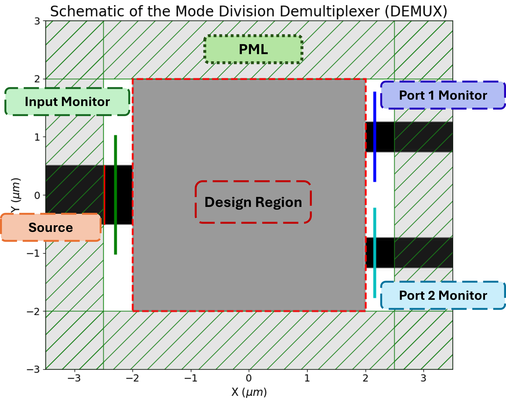
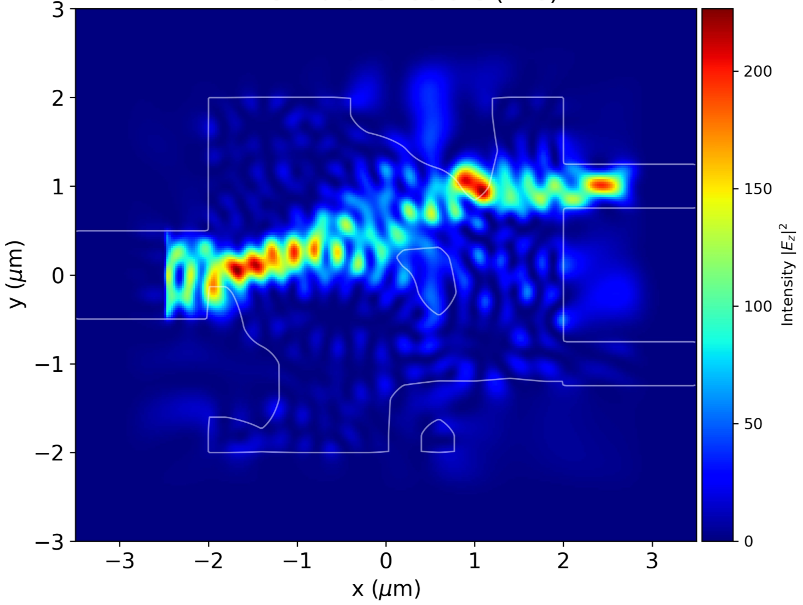
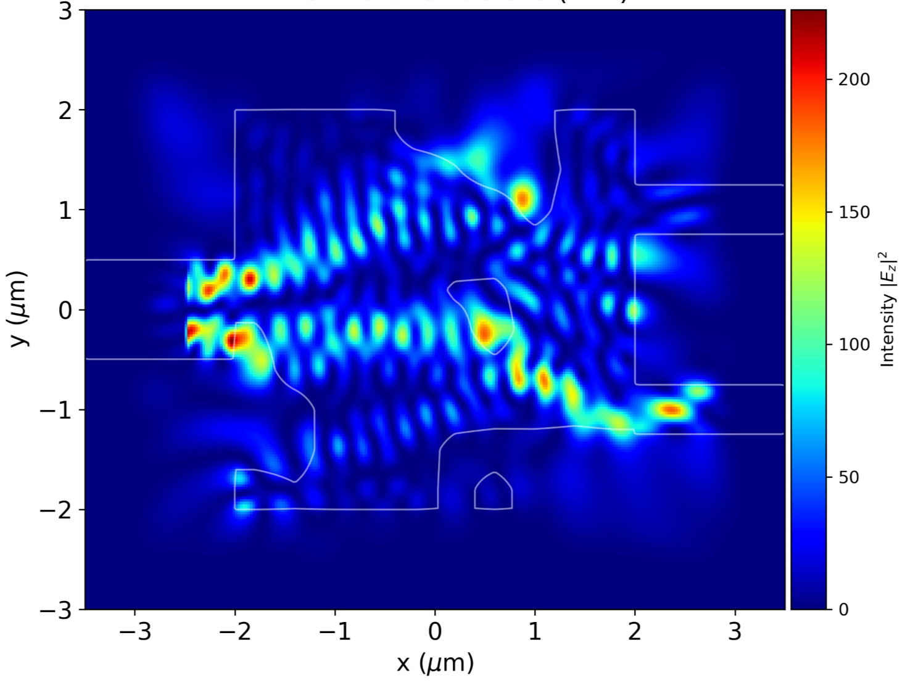
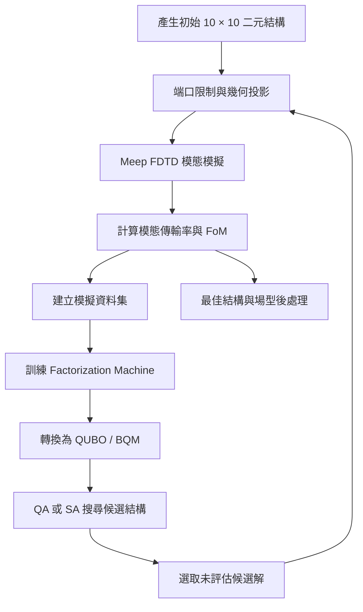

```mermaid
flowchart TD
    A["產生初始 10 × 10 二元結構"] --> B["端口限制與幾何投影"]
    B --> C["Meep FDTD 模態模擬"]
    C --> D["計算模態傳輸率與 FoM"]
    D --> E["建立模擬資料集"]
    E --> F["訓練 Factorization Machine"]
    F --> G["轉換為 QUBO / BQM"]
    G --> H["QA 或 SA 搜尋候選結構"]
    H --> I["選取未評估候選解"]
    I --> B
    D --> J["最佳結構與場型後處理"]
```

<div align="center">

<h1>
  矽光子模態分波解多工器反向設計<br>
  反向設計與 FDTD 模擬教學<br>
  <span style="font-size: 0.25em;">
    Inverse Design of a Silicon Photonic Mode-Division Demultiplexer
  </span>
</h1>

<p>
  <strong>
    以二元材料編碼描述多模態波導之設計區域，<br>
    結合 Meep FDTD、Factorization Machine 與 QUBO Annealing，探索 TE 模態分波結構。
  </strong>
</p>

<p>
  <a href="#概述">概述</a> ·
  <a href="#研究目標">研究目標</a> ·
  <a href="#方法">方法</a> ·
  <a href="#模擬設定">模擬設定</a> ·
  <a href="#程式架構">程式架構</a> ·
  <a href="#執行方式">執行方式</a> ·
  <a href="#限制與注意事項">限制</a> ·
  <a href="#參考資料">參考資料</a>
</p>

<p>
  
  
  
  
  
  
</p>

</div>

## 概述

模態分波解多工器（Mode-Division Demultiplexer, MDM Demux）可將多模態波導中的不同空間模態導引至不同輸出通道，是矽光子積體電路中進行模態多工與訊號路由的重要元件。設計區域內的材料分佈會影響模態轉換、輸出傳輸及非目標通道的串擾，因此可將元件設計表述為一個以電磁模擬評估的離散結構最佳化問題。

本 Repository 建立一個以 **10 × 10 二元設計網格**表示中央材料區域的反向設計流程。候選結構經 Gaussian smoothing 與 Tanh projection 形成平滑材料分佈，再由 Meep 執行二維有限差分時域法（Finite-Difference Time-Domain, FDTD）模擬。輸入端激發 TE₀ 或 TE₁ 模態，並透過輸出端模態分解取得各通道的傳輸係數。

在最佳化階段，使用二階因子分解機（Factorization Machine, FM）學習設計變數與 Figure of Merit（FoM）之間的關係，將 FM 參數轉換為二次無約束二元最佳化（Quadratic Unconstrained Binary Optimization, QUBO）模型，再以量子退火（Quantum Annealing, QA）或模擬退火（Simulated Annealing, SA）搜尋候選解。新候選結構會重新交由 Meep 評估，並加入資料集進行下一輪代理模型訓練。

<p align="center">
  
  <br><em>圖 1. 模態分波解多工器示意圖。</em>
</p>

> **模型範圍：** 目前程式採用二維 MEEP 模型，材料沿模擬平面外方向以 <code>mp.inf</code> 延伸。此模型未完整描述有限厚度 SOI 波導的垂直侷限，模擬結果不應直接解讀為三維元件或實際製程量測結果。

## 研究目標

本專案以兩個輸入模態及兩個輸出通道建立模態路由目標：

- **TE₀ 輸入：** 目標傳輸至輸出端口 1（$`y=+1.5\,\mu\mathrm{m}`$）。
- **TE₁ 輸入：** 目標傳輸至輸出端口 2（$`y=-1.5\,\mu\mathrm{m}`$）。
- **非目標通道：** 降低 TE₀ 至端口 2，以及 TE₁ 至端口 1 的傳輸，以抑制模態串擾。

現有素材亦包含以不同輸入模態進行模擬的場型圖：

<p align="center">
  
  
  <br><em>圖 2. 左圖為 TE₀ 輸入場型；右圖為 TE₁ 輸入場型。</em>
</p>

以下列出本專案目前提供之代表性模擬結果。數值應與其對應的設計結構、中心波長、材料模型及 FDTD 模擬設定一併解讀。

## 方法

### 1. 整體反向設計流程

各候選結構皆由 Meep FDTD 進行物理評估。FM 代理模型負責近似設計變數與 FoM 的關係，QUBO sampler 則提供下一輪候選二元組態。



### 2. 二元結構編碼與幾何投影

設計變數為 <div align="center">

<h1>
  矽光子模態分波解多工器反向設計<br>
  反向設計與 FDTD 模擬教學<br>
  <span style="font-size: 0.25em;">
    Inverse Design of a Silicon Photonic Mode-Division Demultiplexer
  </span>
</h1>

<p>
  <strong>
    以二元材料編碼描述多模態波導之設計區域，<br>
    結合 Meep FDTD、Factorization Machine 與 QUBO Annealing，探索 TE 模態分波結構。
  </strong>
</p>

<p>
  <a href="#概述">概述</a> ·
  <a href="#研究目標">研究目標</a> ·
  <a href="#方法">方法</a> ·
  <a href="#模擬設定">模擬設定</a> ·
  <a href="#程式架構">程式架構</a> ·
  <a href="#執行方式">執行方式</a> ·
  <a href="#限制與注意事項">限制</a> ·
  <a href="#參考資料">參考資料</a>
</p>

<p>
  
  
  
  
  
  
</p>

</div>

## 概述

模態分波解多工器（Mode-Division Demultiplexer, MDM Demux）可將多模態波導中的不同空間模態導引至不同輸出通道，是矽光子積體電路中進行模態多工與訊號路由的重要元件。設計區域內的材料分佈會影響模態轉換、輸出傳輸及非目標通道的串擾，因此可將元件設計表述為一個以電磁模擬評估的離散結構最佳化問題。

本 Repository 建立一個以 **10 × 10 二元設計網格**表示中央材料區域的反向設計流程。候選結構經 Gaussian smoothing 與 Tanh projection 形成平滑材料分佈，再由 Meep 執行二維有限差分時域法（Finite-Difference Time-Domain, FDTD）模擬。輸入端激發 TE₀ 或 TE₁ 模態，並透過輸出端模態分解取得各通道的傳輸係數。

在最佳化階段，使用二階因子分解機（Factorization Machine, FM）學習設計變數與 Figure of Merit（FoM）之間的關係，將 FM 參數轉換為二次無約束二元最佳化（Quadratic Unconstrained Binary Optimization, QUBO）模型，再以量子退火（Quantum Annealing, QA）或模擬退火（Simulated Annealing, SA）搜尋候選解。新候選結構會重新交由 Meep 評估，並加入資料集進行下一輪代理模型訓練。

<p align="center">
  
  <br><em>圖 1. 模態分波解多工器示意圖。</em>
</p>

> **模型範圍：** 目前程式採用二維 MEEP 模型，材料沿模擬平面外方向以 <code>mp.inf</code> 延伸。此模型未完整描述有限厚度 SOI 波導的垂直侷限，模擬結果不應直接解讀為三維元件或實際製程量測結果。

## 研究目標

本專案以兩個輸入模態及兩個輸出通道建立模態路由目標：

- **TE₀ 輸入：** 目標傳輸至輸出端口 1（$`y=+1.5\,\mu\mathrm{m}`$）。
- **TE₁ 輸入：** 目標傳輸至輸出端口 2（$`y=-1.5\,\mu\mathrm{m}`$）。
- **非目標通道：** 降低 TE₀ 至端口 2，以及 TE₁ 至端口 1 的傳輸，以抑制模態串擾。

現有素材亦包含以不同輸入模態進行模擬的場型圖：

<p align="center">
  
  
  <br><em>圖 2. 左圖為 TE₀ 輸入場型；右圖為 TE₁ 輸入場型。</em>
</p>

以下列出本專案目前提供之代表性模擬結果。數值應與其對應的設計結構、中心波長、材料模型及 FDTD 模擬設定一併解讀。

## 方法

### 1. 整體反向設計流程

各候選結構皆由 Meep FDTD 進行物理評估。FM 代理模型負責近似設計變數與 FoM 的關係，QUBO sampler 則提供下一輪候選二元組態。


### 2. 二元結構編碼與幾何投影

10\times10`$ 二元矩陣，展平成 100 維向量：
```math
\mathbf{x}\in\{0,1\}^{100}.
```
程式以 0、1 表示二氧化矽與矽的材料權重。首先套用輸入與輸出端口限制，固定設計區域邊界的端口幾何，並保留指定 padding；接著使用 Gaussian kernel 平滑二元分佈：
```math
\rho=G_\sigma * X,
\qquad
G_\sigma(i,j)\propto
\exp\left[-\frac{i^2+j^2}{2\sigma^2}\right].
```
平滑後的密度透過 Tanh projection 轉換：
```math
\tilde{\rho}=
\frac{
\tanh(\beta\eta)+\tanh[\beta(\rho-\eta)]
}{
\tanh(\beta\eta)+\tanh[\beta(1-\eta)]
}.
```
Notebook 預設採用 $`5\times5`$ Gaussian kernel、$`\sigma=0.5`$、$`\beta=50`$、$`\eta=0.5`$，並將投影密度映射至 Meep <code>MaterialGrid</code>。此參數化方式保留二元搜尋變數，同時透過平滑與投影控制材料邊界。

### 3. FDTD 模擬與模態傳輸

模擬以 Meep <code>EigenModeSource</code> 激發輸入波導中的 TE 模態：

| 模態 | 輸入本徵模態設定 | 目標輸出端口 |
|---|---|---|
| TE₀ | band 1、偶對稱（<code>mp.EVEN_Y</code>） | Port 1，$`y=+1.5\,\mu\mathrm{m}`$ |
| TE₁ | band 2、奇對稱（<code>mp.ODD_Y</code>） | Port 2，$`y=-1.5\,\mu\mathrm{m}`$ |

令 $`T_{ij}`$ 表示輸入模態 $`i`$ 傳輸至輸出端口 $`j`$ 的功率比：
```math
T_{ij}=
\frac{|\alpha_{i\rightarrow j}^{\mathrm{out}}|^2}
{|\alpha_i^{\mathrm{in}}|^2+\epsilon},
```
其中 $`\alpha`$ 為 Meep 模態分解所得的複數模態係數，$`\epsilon`$ 為數值穩定項。目標通道為 $`T_{01}`$ 與 $`T_{12}`$，非目標通道為 $`T_{02}`$ 與 $`T_{11}`$。

### 4. FoM 定義

採用乘積型目標函數：
```math
S_{\mathrm{TE0}}=T_{01}(1-T_{02}),
\qquad
S_{\mathrm{TE1}}=T_{12}(1-T_{11}),
```
```math
\mathrm{FoM}_{\mathrm{NB}}=
S_{\mathrm{TE0}}S_{\mathrm{TE1}}.
```
目標為最大化 FoM；程式回傳 $`-\mathrm{FoM}`$，以符合 QUBO sampler 的能量最小化形式。

### 5. FM 模型與 QUBO 建構

本專案使用 PyTorch 實作二階 Factorization Machine。模型架構、前向傳播、訓練流程，以及由模型參數擷取二次交互作用係數的實作細節，請參考獨立教學 Repository：[Factorization Machine in PyTorch](https://github.com/Oscar7769/Factorization_Machine_in_PyTorch)。

在本模態分波器設計流程中，訓練完成的 FM 模型透過 `get_bhQ()` 取得偏置、線性係數與二次交互作用矩陣，再由 `dimod.BinaryQuadraticModel` 建立 BQM，供量子退火或模擬退火取樣器搜尋候選設計組態。

QUBO 的二元能量形式為：
```math
E(\mathbf{x})=c+\sum_i h_i x_i+\sum_{i<j}Q_{ij}x_ix_j,
\qquad x_i\in\{0,1\}.
```
取樣器產生候選組態後，仍須以 Meep FDTD 重新計算 FoM；代理模型預測值不會取代最終電磁模擬。

### 6. MPI 平行化

程式使用 MPI Master–Worker 架構。Master（rank 0）負責建立資料集、訓練 FM、建構 BQM 及更新最佳解；Worker ranks 負責接收設計向量、執行 Meep 模擬並回傳 FoM。初始樣本與每輪新增候選解的評估工作可因此分配至多個 processes。

## 模擬設定

以下整理本專案 Notebook 與純 Python 腳本共用的預設模擬及最佳化參數。

### 電磁模型參數

| 參數 | Notebook 設定 | 說明 |
|---|---:|---|
| 模擬維度 | 2D | 二維 FDTD |
| 設計區域 | <div align="center">

<h1>
  矽光子模態分波解多工器反向設計<br>
  反向設計與 FDTD 模擬教學<br>
  <span style="font-size: 0.25em;">
    Inverse Design of a Silicon Photonic Mode-Division Demultiplexer
  </span>
</h1>

<p>
  <strong>
    以二元材料編碼描述多模態波導之設計區域，<br>
    結合 Meep FDTD、Factorization Machine 與 QUBO Annealing，探索 TE 模態分波結構。
  </strong>
</p>

<p>
  <a href="#概述">概述</a> ·
  <a href="#研究目標">研究目標</a> ·
  <a href="#方法">方法</a> ·
  <a href="#模擬設定">模擬設定</a> ·
  <a href="#程式架構">程式架構</a> ·
  <a href="#執行方式">執行方式</a> ·
  <a href="#限制與注意事項">限制</a> ·
  <a href="#參考資料">參考資料</a>
</p>

<p>
  
  
  
  
  
  
</p>

</div>

## 概述

模態分波解多工器（Mode-Division Demultiplexer, MDM Demux）可將多模態波導中的不同空間模態導引至不同輸出通道，是矽光子積體電路中進行模態多工與訊號路由的重要元件。設計區域內的材料分佈會影響模態轉換、輸出傳輸及非目標通道的串擾，因此可將元件設計表述為一個以電磁模擬評估的離散結構最佳化問題。

本 Repository 建立一個以 **10 × 10 二元設計網格**表示中央材料區域的反向設計流程。候選結構經 Gaussian smoothing 與 Tanh projection 形成平滑材料分佈，再由 Meep 執行二維有限差分時域法（Finite-Difference Time-Domain, FDTD）模擬。輸入端激發 TE₀ 或 TE₁ 模態，並透過輸出端模態分解取得各通道的傳輸係數。

在最佳化階段，使用二階因子分解機（Factorization Machine, FM）學習設計變數與 Figure of Merit（FoM）之間的關係，將 FM 參數轉換為二次無約束二元最佳化（Quadratic Unconstrained Binary Optimization, QUBO）模型，再以量子退火（Quantum Annealing, QA）或模擬退火（Simulated Annealing, SA）搜尋候選解。新候選結構會重新交由 Meep 評估，並加入資料集進行下一輪代理模型訓練。

<p align="center">
  
  <br><em>圖 1. 模態分波解多工器示意圖。</em>
</p>

> **模型範圍：** 目前程式採用二維 MEEP 模型，材料沿模擬平面外方向以 <code>mp.inf</code> 延伸。此模型未完整描述有限厚度 SOI 波導的垂直侷限，模擬結果不應直接解讀為三維元件或實際製程量測結果。

## 研究目標

本專案以兩個輸入模態及兩個輸出通道建立模態路由目標：

- **TE₀ 輸入：** 目標傳輸至輸出端口 1（$`y=+1.5\,\mu\mathrm{m}`$）。
- **TE₁ 輸入：** 目標傳輸至輸出端口 2（$`y=-1.5\,\mu\mathrm{m}`$）。
- **非目標通道：** 降低 TE₀ 至端口 2，以及 TE₁ 至端口 1 的傳輸，以抑制模態串擾。

現有素材亦包含以不同輸入模態進行模擬的場型圖：

<p align="center">
  
  
  <br><em>圖 2. 左圖為 TE₀ 輸入場型；右圖為 TE₁ 輸入場型。</em>
</p>

以下列出本專案目前提供之代表性模擬結果。數值應與其對應的設計結構、中心波長、材料模型及 FDTD 模擬設定一併解讀。

## 方法

### 1. 整體反向設計流程

各候選結構皆由 Meep FDTD 進行物理評估。FM 代理模型負責近似設計變數與 FoM 的關係，QUBO sampler 則提供下一輪候選二元組態。


### 2. 二元結構編碼與幾何投影

設計變數為 <div align="center">

<h1>
  矽光子模態分波解多工器反向設計<br>
  反向設計與 FDTD 模擬教學<br>
  <span style="font-size: 0.25em;">
    Inverse Design of a Silicon Photonic Mode-Division Demultiplexer
  </span>
</h1>

<p>
  <strong>
    以二元材料編碼描述多模態波導之設計區域，<br>
    結合 Meep FDTD、Factorization Machine 與 QUBO Annealing，探索 TE 模態分波結構。
  </strong>
</p>

<p>
  <a href="#概述">概述</a> ·
  <a href="#研究目標">研究目標</a> ·
  <a href="#方法">方法</a> ·
  <a href="#模擬設定">模擬設定</a> ·
  <a href="#程式架構">程式架構</a> ·
  <a href="#執行方式">執行方式</a> ·
  <a href="#限制與注意事項">限制</a> ·
  <a href="#參考資料">參考資料</a>
</p>

<p>
  
  
  
  
  
  
</p>

</div>

## 概述

模態分波解多工器（Mode-Division Demultiplexer, MDM Demux）可將多模態波導中的不同空間模態導引至不同輸出通道，是矽光子積體電路中進行模態多工與訊號路由的重要元件。設計區域內的材料分佈會影響模態轉換、輸出傳輸及非目標通道的串擾，因此可將元件設計表述為一個以電磁模擬評估的離散結構最佳化問題。

本 Repository 建立一個以 **10 × 10 二元設計網格**表示中央材料區域的反向設計流程。候選結構經 Gaussian smoothing 與 Tanh projection 形成平滑材料分佈，再由 Meep 執行二維有限差分時域法（Finite-Difference Time-Domain, FDTD）模擬。輸入端激發 TE₀ 或 TE₁ 模態，並透過輸出端模態分解取得各通道的傳輸係數。

在最佳化階段，使用二階因子分解機（Factorization Machine, FM）學習設計變數與 Figure of Merit（FoM）之間的關係，將 FM 參數轉換為二次無約束二元最佳化（Quadratic Unconstrained Binary Optimization, QUBO）模型，再以量子退火（Quantum Annealing, QA）或模擬退火（Simulated Annealing, SA）搜尋候選解。新候選結構會重新交由 Meep 評估，並加入資料集進行下一輪代理模型訓練。

<p align="center">
  
  <br><em>圖 1. 模態分波解多工器示意圖。</em>
</p>

> **模型範圍：** 目前程式採用二維 MEEP 模型，材料沿模擬平面外方向以 <code>mp.inf</code> 延伸。此模型未完整描述有限厚度 SOI 波導的垂直侷限，模擬結果不應直接解讀為三維元件或實際製程量測結果。

## 研究目標

本專案以兩個輸入模態及兩個輸出通道建立模態路由目標：

- **TE₀ 輸入：** 目標傳輸至輸出端口 1（$`y=+1.5\,\mu\mathrm{m}`$）。
- **TE₁ 輸入：** 目標傳輸至輸出端口 2（$`y=-1.5\,\mu\mathrm{m}`$）。
- **非目標通道：** 降低 TE₀ 至端口 2，以及 TE₁ 至端口 1 的傳輸，以抑制模態串擾。

現有素材亦包含以不同輸入模態進行模擬的場型圖：

<p align="center">
  
  
  <br><em>圖 2. 左圖為 TE₀ 輸入場型；右圖為 TE₁ 輸入場型。</em>
</p>

以下列出本專案目前提供之代表性模擬結果。數值應與其對應的設計結構、中心波長、材料模型及 FDTD 模擬設定一併解讀。

## 方法

### 1. 整體反向設計流程

各候選結構皆由 Meep FDTD 進行物理評估。FM 代理模型負責近似設計變數與 FoM 的關係，QUBO sampler 則提供下一輪候選二元組態。


### 2. 二元結構編碼與幾何投影

10\times10`$ 二元矩陣，展平成 100 維向量：
```math
\mathbf{x}\in\{0,1\}^{100}.
```
程式以 0、1 表示二氧化矽與矽的材料權重。首先套用輸入與輸出端口限制，固定設計區域邊界的端口幾何，並保留指定 padding；接著使用 Gaussian kernel 平滑二元分佈：
```math
\rho=G_\sigma * X,
\qquad
G_\sigma(i,j)\propto
\exp\left[-\frac{i^2+j^2}{2\sigma^2}\right].
```
平滑後的密度透過 Tanh projection 轉換：
```math
\tilde{\rho}=
\frac{
\tanh(\beta\eta)+\tanh[\beta(\rho-\eta)]
}{
\tanh(\beta\eta)+\tanh[\beta(1-\eta)]
}.
```
Notebook 預設採用 $`5\times5`$ Gaussian kernel、$`\sigma=0.5`$、$`\beta=50`$、$`\eta=0.5`$，並將投影密度映射至 Meep <code>MaterialGrid</code>。此參數化方式保留二元搜尋變數，同時透過平滑與投影控制材料邊界。

### 3. FDTD 模擬與模態傳輸

模擬以 Meep <code>EigenModeSource</code> 激發輸入波導中的 TE 模態：

| 模態 | 輸入本徵模態設定 | 目標輸出端口 |
|---|---|---|
| TE₀ | band 1、偶對稱（<code>mp.EVEN_Y</code>） | Port 1，$`y=+1.5\,\mu\mathrm{m}`$ |
| TE₁ | band 2、奇對稱（<code>mp.ODD_Y</code>） | Port 2，$`y=-1.5\,\mu\mathrm{m}`$ |

令 $`T_{ij}`$ 表示輸入模態 $`i`$ 傳輸至輸出端口 $`j`$ 的功率比：
```math
T_{ij}=
\frac{|\alpha_{i\rightarrow j}^{\mathrm{out}}|^2}
{|\alpha_i^{\mathrm{in}}|^2+\epsilon},
```
其中 $`\alpha`$ 為 Meep 模態分解所得的複數模態係數，$`\epsilon`$ 為數值穩定項。目標通道為 $`T_{01}`$ 與 $`T_{12}`$，非目標通道為 $`T_{02}`$ 與 $`T_{11}`$。

### 4. FoM 定義

採用乘積型目標函數：
```math
S_{\mathrm{TE0}}=T_{01}(1-T_{02}),
\qquad
S_{\mathrm{TE1}}=T_{12}(1-T_{11}),
```
```math
\mathrm{FoM}_{\mathrm{NB}}=
S_{\mathrm{TE0}}S_{\mathrm{TE1}}.
```
目標為最大化 FoM；程式回傳 $`-\mathrm{FoM}`$，以符合 QUBO sampler 的能量最小化形式。

### 5. FM 模型與 QUBO 建構

本專案使用 PyTorch 實作二階 Factorization Machine。模型架構、前向傳播、訓練流程，以及由模型參數擷取二次交互作用係數的實作細節，請參考獨立教學 Repository：[Factorization Machine in PyTorch](https://github.com/Oscar7769/Factorization_Machine_in_PyTorch)。

在本模態分波器設計流程中，訓練完成的 FM 模型透過 `get_bhQ()` 取得偏置、線性係數與二次交互作用矩陣，再由 `dimod.BinaryQuadraticModel` 建立 BQM，供量子退火或模擬退火取樣器搜尋候選設計組態。

QUBO 的二元能量形式為：
```math
E(\mathbf{x})=c+\sum_i h_i x_i+\sum_{i<j}Q_{ij}x_ix_j,
\qquad x_i\in\{0,1\}.
```
取樣器產生候選組態後，仍須以 Meep FDTD 重新計算 FoM；代理模型預測值不會取代最終電磁模擬。

### 6. MPI 平行化

程式使用 MPI Master–Worker 架構。Master（rank 0）負責建立資料集、訓練 FM、建構 BQM 及更新最佳解；Worker ranks 負責接收設計向量、執行 Meep 模擬並回傳 FoM。初始樣本與每輪新增候選解的評估工作可因此分配至多個 processes。

## 模擬設定

以下整理本專案 Notebook 與純 Python 腳本共用的預設模擬及最佳化參數。

### 電磁模型參數

| 參數 | Notebook 設定 | 說明 |
|---|---:|---|
| 模擬維度 | 2D | 二維 FDTD |
| 設計區域 | 4.0\times4.0\,\mu\mathrm{m}^2`$ | 中央材料設計區 |
| 模擬區域 | <div align="center">

<h1>
  矽光子模態分波解多工器反向設計<br>
  反向設計與 FDTD 模擬教學<br>
  <span style="font-size: 0.25em;">
    Inverse Design of a Silicon Photonic Mode-Division Demultiplexer
  </span>
</h1>

<p>
  <strong>
    以二元材料編碼描述多模態波導之設計區域，<br>
    結合 Meep FDTD、Factorization Machine 與 QUBO Annealing，探索 TE 模態分波結構。
  </strong>
</p>

<p>
  <a href="#概述">概述</a> ·
  <a href="#研究目標">研究目標</a> ·
  <a href="#方法">方法</a> ·
  <a href="#模擬設定">模擬設定</a> ·
  <a href="#程式架構">程式架構</a> ·
  <a href="#執行方式">執行方式</a> ·
  <a href="#限制與注意事項">限制</a> ·
  <a href="#參考資料">參考資料</a>
</p>

<p>
  
  
  
  
  
  
</p>

</div>

## 概述

模態分波解多工器（Mode-Division Demultiplexer, MDM Demux）可將多模態波導中的不同空間模態導引至不同輸出通道，是矽光子積體電路中進行模態多工與訊號路由的重要元件。設計區域內的材料分佈會影響模態轉換、輸出傳輸及非目標通道的串擾，因此可將元件設計表述為一個以電磁模擬評估的離散結構最佳化問題。

本 Repository 建立一個以 **10 × 10 二元設計網格**表示中央材料區域的反向設計流程。候選結構經 Gaussian smoothing 與 Tanh projection 形成平滑材料分佈，再由 Meep 執行二維有限差分時域法（Finite-Difference Time-Domain, FDTD）模擬。輸入端激發 TE₀ 或 TE₁ 模態，並透過輸出端模態分解取得各通道的傳輸係數。

在最佳化階段，使用二階因子分解機（Factorization Machine, FM）學習設計變數與 Figure of Merit（FoM）之間的關係，將 FM 參數轉換為二次無約束二元最佳化（Quadratic Unconstrained Binary Optimization, QUBO）模型，再以量子退火（Quantum Annealing, QA）或模擬退火（Simulated Annealing, SA）搜尋候選解。新候選結構會重新交由 Meep 評估，並加入資料集進行下一輪代理模型訓練。

<p align="center">
  
  <br><em>圖 1. 模態分波解多工器示意圖。</em>
</p>

> **模型範圍：** 目前程式採用二維 MEEP 模型，材料沿模擬平面外方向以 <code>mp.inf</code> 延伸。此模型未完整描述有限厚度 SOI 波導的垂直侷限，模擬結果不應直接解讀為三維元件或實際製程量測結果。

## 研究目標

本專案以兩個輸入模態及兩個輸出通道建立模態路由目標：

- **TE₀ 輸入：** 目標傳輸至輸出端口 1（$`y=+1.5\,\mu\mathrm{m}`$）。
- **TE₁ 輸入：** 目標傳輸至輸出端口 2（$`y=-1.5\,\mu\mathrm{m}`$）。
- **非目標通道：** 降低 TE₀ 至端口 2，以及 TE₁ 至端口 1 的傳輸，以抑制模態串擾。

現有素材亦包含以不同輸入模態進行模擬的場型圖：

<p align="center">
  
  
  <br><em>圖 2. 左圖為 TE₀ 輸入場型；右圖為 TE₁ 輸入場型。</em>
</p>

以下列出本專案目前提供之代表性模擬結果。數值應與其對應的設計結構、中心波長、材料模型及 FDTD 模擬設定一併解讀。

## 方法

### 1. 整體反向設計流程

各候選結構皆由 Meep FDTD 進行物理評估。FM 代理模型負責近似設計變數與 FoM 的關係，QUBO sampler 則提供下一輪候選二元組態。


### 2. 二元結構編碼與幾何投影

設計變數為 <div align="center">

<h1>
  矽光子模態分波解多工器反向設計<br>
  反向設計與 FDTD 模擬教學<br>
  <span style="font-size: 0.25em;">
    Inverse Design of a Silicon Photonic Mode-Division Demultiplexer
  </span>
</h1>

<p>
  <strong>
    以二元材料編碼描述多模態波導之設計區域，<br>
    結合 Meep FDTD、Factorization Machine 與 QUBO Annealing，探索 TE 模態分波結構。
  </strong>
</p>

<p>
  <a href="#概述">概述</a> ·
  <a href="#研究目標">研究目標</a> ·
  <a href="#方法">方法</a> ·
  <a href="#模擬設定">模擬設定</a> ·
  <a href="#程式架構">程式架構</a> ·
  <a href="#執行方式">執行方式</a> ·
  <a href="#限制與注意事項">限制</a> ·
  <a href="#參考資料">參考資料</a>
</p>

<p>
  
  
  
  
  
  
</p>

</div>

## 概述

模態分波解多工器（Mode-Division Demultiplexer, MDM Demux）可將多模態波導中的不同空間模態導引至不同輸出通道，是矽光子積體電路中進行模態多工與訊號路由的重要元件。設計區域內的材料分佈會影響模態轉換、輸出傳輸及非目標通道的串擾，因此可將元件設計表述為一個以電磁模擬評估的離散結構最佳化問題。

本 Repository 建立一個以 **10 × 10 二元設計網格**表示中央材料區域的反向設計流程。候選結構經 Gaussian smoothing 與 Tanh projection 形成平滑材料分佈，再由 Meep 執行二維有限差分時域法（Finite-Difference Time-Domain, FDTD）模擬。輸入端激發 TE₀ 或 TE₁ 模態，並透過輸出端模態分解取得各通道的傳輸係數。

在最佳化階段，使用二階因子分解機（Factorization Machine, FM）學習設計變數與 Figure of Merit（FoM）之間的關係，將 FM 參數轉換為二次無約束二元最佳化（Quadratic Unconstrained Binary Optimization, QUBO）模型，再以量子退火（Quantum Annealing, QA）或模擬退火（Simulated Annealing, SA）搜尋候選解。新候選結構會重新交由 Meep 評估，並加入資料集進行下一輪代理模型訓練。

<p align="center">
  
  <br><em>圖 1. 模態分波解多工器示意圖。</em>
</p>

> **模型範圍：** 目前程式採用二維 MEEP 模型，材料沿模擬平面外方向以 <code>mp.inf</code> 延伸。此模型未完整描述有限厚度 SOI 波導的垂直侷限，模擬結果不應直接解讀為三維元件或實際製程量測結果。

## 研究目標

本專案以兩個輸入模態及兩個輸出通道建立模態路由目標：

- **TE₀ 輸入：** 目標傳輸至輸出端口 1（$`y=+1.5\,\mu\mathrm{m}`$）。
- **TE₁ 輸入：** 目標傳輸至輸出端口 2（$`y=-1.5\,\mu\mathrm{m}`$）。
- **非目標通道：** 降低 TE₀ 至端口 2，以及 TE₁ 至端口 1 的傳輸，以抑制模態串擾。

現有素材亦包含以不同輸入模態進行模擬的場型圖：

<p align="center">
  
  
  <br><em>圖 2. 左圖為 TE₀ 輸入場型；右圖為 TE₁ 輸入場型。</em>
</p>

以下列出本專案目前提供之代表性模擬結果。數值應與其對應的設計結構、中心波長、材料模型及 FDTD 模擬設定一併解讀。

## 方法

### 1. 整體反向設計流程

各候選結構皆由 Meep FDTD 進行物理評估。FM 代理模型負責近似設計變數與 FoM 的關係，QUBO sampler 則提供下一輪候選二元組態。


### 2. 二元結構編碼與幾何投影

10\times10`$ 二元矩陣，展平成 100 維向量：
```math
\mathbf{x}\in\{0,1\}^{100}.
```
程式以 0、1 表示二氧化矽與矽的材料權重。首先套用輸入與輸出端口限制，固定設計區域邊界的端口幾何，並保留指定 padding；接著使用 Gaussian kernel 平滑二元分佈：
```math
\rho=G_\sigma * X,
\qquad
G_\sigma(i,j)\propto
\exp\left[-\frac{i^2+j^2}{2\sigma^2}\right].
```
平滑後的密度透過 Tanh projection 轉換：
```math
\tilde{\rho}=
\frac{
\tanh(\beta\eta)+\tanh[\beta(\rho-\eta)]
}{
\tanh(\beta\eta)+\tanh[\beta(1-\eta)]
}.
```
Notebook 預設採用 $`5\times5`$ Gaussian kernel、$`\sigma=0.5`$、$`\beta=50`$、$`\eta=0.5`$，並將投影密度映射至 Meep <code>MaterialGrid</code>。此參數化方式保留二元搜尋變數，同時透過平滑與投影控制材料邊界。

### 3. FDTD 模擬與模態傳輸

模擬以 Meep <code>EigenModeSource</code> 激發輸入波導中的 TE 模態：

| 模態 | 輸入本徵模態設定 | 目標輸出端口 |
|---|---|---|
| TE₀ | band 1、偶對稱（<code>mp.EVEN_Y</code>） | Port 1，$`y=+1.5\,\mu\mathrm{m}`$ |
| TE₁ | band 2、奇對稱（<code>mp.ODD_Y</code>） | Port 2，$`y=-1.5\,\mu\mathrm{m}`$ |

令 $`T_{ij}`$ 表示輸入模態 $`i`$ 傳輸至輸出端口 $`j`$ 的功率比：
```math
T_{ij}=
\frac{|\alpha_{i\rightarrow j}^{\mathrm{out}}|^2}
{|\alpha_i^{\mathrm{in}}|^2+\epsilon},
```
其中 $`\alpha`$ 為 Meep 模態分解所得的複數模態係數，$`\epsilon`$ 為數值穩定項。目標通道為 $`T_{01}`$ 與 $`T_{12}`$，非目標通道為 $`T_{02}`$ 與 $`T_{11}`$。

### 4. FoM 定義

採用乘積型目標函數：
```math
S_{\mathrm{TE0}}=T_{01}(1-T_{02}),
\qquad
S_{\mathrm{TE1}}=T_{12}(1-T_{11}),
```
```math
\mathrm{FoM}_{\mathrm{NB}}=
S_{\mathrm{TE0}}S_{\mathrm{TE1}}.
```
目標為最大化 FoM；程式回傳 $`-\mathrm{FoM}`$，以符合 QUBO sampler 的能量最小化形式。

### 5. FM 模型與 QUBO 建構

本專案使用 PyTorch 實作二階 Factorization Machine。模型架構、前向傳播、訓練流程，以及由模型參數擷取二次交互作用係數的實作細節，請參考獨立教學 Repository：[Factorization Machine in PyTorch](https://github.com/Oscar7769/Factorization_Machine_in_PyTorch)。

在本模態分波器設計流程中，訓練完成的 FM 模型透過 `get_bhQ()` 取得偏置、線性係數與二次交互作用矩陣，再由 `dimod.BinaryQuadraticModel` 建立 BQM，供量子退火或模擬退火取樣器搜尋候選設計組態。

QUBO 的二元能量形式為：
```math
E(\mathbf{x})=c+\sum_i h_i x_i+\sum_{i<j}Q_{ij}x_ix_j,
\qquad x_i\in\{0,1\}.
```
取樣器產生候選組態後，仍須以 Meep FDTD 重新計算 FoM；代理模型預測值不會取代最終電磁模擬。

### 6. MPI 平行化

程式使用 MPI Master–Worker 架構。Master（rank 0）負責建立資料集、訓練 FM、建構 BQM 及更新最佳解；Worker ranks 負責接收設計向量、執行 Meep 模擬並回傳 FoM。初始樣本與每輪新增候選解的評估工作可因此分配至多個 processes。

## 模擬設定

以下整理本專案 Notebook 與純 Python 腳本共用的預設模擬及最佳化參數。

### 電磁模型參數

| 參數 | Notebook 設定 | 說明 |
|---|---:|---|
| 模擬維度 | 2D | 二維 FDTD |
| 設計區域 | <div align="center">

<h1>
  矽光子模態分波解多工器反向設計<br>
  反向設計與 FDTD 模擬教學<br>
  <span style="font-size: 0.25em;">
    Inverse Design of a Silicon Photonic Mode-Division Demultiplexer
  </span>
</h1>

<p>
  <strong>
    以二元材料編碼描述多模態波導之設計區域，<br>
    結合 Meep FDTD、Factorization Machine 與 QUBO Annealing，探索 TE 模態分波結構。
  </strong>
</p>

<p>
  <a href="#概述">概述</a> ·
  <a href="#研究目標">研究目標</a> ·
  <a href="#方法">方法</a> ·
  <a href="#模擬設定">模擬設定</a> ·
  <a href="#程式架構">程式架構</a> ·
  <a href="#執行方式">執行方式</a> ·
  <a href="#限制與注意事項">限制</a> ·
  <a href="#參考資料">參考資料</a>
</p>

<p>
  
  
  
  
  
  
</p>

</div>

## 概述

模態分波解多工器（Mode-Division Demultiplexer, MDM Demux）可將多模態波導中的不同空間模態導引至不同輸出通道，是矽光子積體電路中進行模態多工與訊號路由的重要元件。設計區域內的材料分佈會影響模態轉換、輸出傳輸及非目標通道的串擾，因此可將元件設計表述為一個以電磁模擬評估的離散結構最佳化問題。

本 Repository 建立一個以 **10 × 10 二元設計網格**表示中央材料區域的反向設計流程。候選結構經 Gaussian smoothing 與 Tanh projection 形成平滑材料分佈，再由 Meep 執行二維有限差分時域法（Finite-Difference Time-Domain, FDTD）模擬。輸入端激發 TE₀ 或 TE₁ 模態，並透過輸出端模態分解取得各通道的傳輸係數。

在最佳化階段，使用二階因子分解機（Factorization Machine, FM）學習設計變數與 Figure of Merit（FoM）之間的關係，將 FM 參數轉換為二次無約束二元最佳化（Quadratic Unconstrained Binary Optimization, QUBO）模型，再以量子退火（Quantum Annealing, QA）或模擬退火（Simulated Annealing, SA）搜尋候選解。新候選結構會重新交由 Meep 評估，並加入資料集進行下一輪代理模型訓練。

<p align="center">
  
  <br><em>圖 1. 模態分波解多工器示意圖。</em>
</p>

> **模型範圍：** 目前程式採用二維 MEEP 模型，材料沿模擬平面外方向以 <code>mp.inf</code> 延伸。此模型未完整描述有限厚度 SOI 波導的垂直侷限，模擬結果不應直接解讀為三維元件或實際製程量測結果。

## 研究目標

本專案以兩個輸入模態及兩個輸出通道建立模態路由目標：

- **TE₀ 輸入：** 目標傳輸至輸出端口 1（$`y=+1.5\,\mu\mathrm{m}`$）。
- **TE₁ 輸入：** 目標傳輸至輸出端口 2（$`y=-1.5\,\mu\mathrm{m}`$）。
- **非目標通道：** 降低 TE₀ 至端口 2，以及 TE₁ 至端口 1 的傳輸，以抑制模態串擾。

現有素材亦包含以不同輸入模態進行模擬的場型圖：

<p align="center">
  
  
  <br><em>圖 2. 左圖為 TE₀ 輸入場型；右圖為 TE₁ 輸入場型。</em>
</p>

以下列出本專案目前提供之代表性模擬結果。數值應與其對應的設計結構、中心波長、材料模型及 FDTD 模擬設定一併解讀。

## 方法

### 1. 整體反向設計流程

各候選結構皆由 Meep FDTD 進行物理評估。FM 代理模型負責近似設計變數與 FoM 的關係，QUBO sampler 則提供下一輪候選二元組態。


### 2. 二元結構編碼與幾何投影

設計變數為 <div align="center">

<h1>
  矽光子模態分波解多工器反向設計<br>
  反向設計與 FDTD 模擬教學<br>
  <span style="font-size: 0.25em;">
    Inverse Design of a Silicon Photonic Mode-Division Demultiplexer
  </span>
</h1>

<p>
  <strong>
    以二元材料編碼描述多模態波導之設計區域，<br>
    結合 Meep FDTD、Factorization Machine 與 QUBO Annealing，探索 TE 模態分波結構。
  </strong>
</p>

<p>
  <a href="#概述">概述</a> ·
  <a href="#研究目標">研究目標</a> ·
  <a href="#方法">方法</a> ·
  <a href="#模擬設定">模擬設定</a> ·
  <a href="#程式架構">程式架構</a> ·
  <a href="#執行方式">執行方式</a> ·
  <a href="#限制與注意事項">限制</a> ·
  <a href="#參考資料">參考資料</a>
</p>

<p>
  
  
  
  
  
  
</p>

</div>

## 概述

模態分波解多工器（Mode-Division Demultiplexer, MDM Demux）可將多模態波導中的不同空間模態導引至不同輸出通道，是矽光子積體電路中進行模態多工與訊號路由的重要元件。設計區域內的材料分佈會影響模態轉換、輸出傳輸及非目標通道的串擾，因此可將元件設計表述為一個以電磁模擬評估的離散結構最佳化問題。

本 Repository 建立一個以 **10 × 10 二元設計網格**表示中央材料區域的反向設計流程。候選結構經 Gaussian smoothing 與 Tanh projection 形成平滑材料分佈，再由 Meep 執行二維有限差分時域法（Finite-Difference Time-Domain, FDTD）模擬。輸入端激發 TE₀ 或 TE₁ 模態，並透過輸出端模態分解取得各通道的傳輸係數。

在最佳化階段，使用二階因子分解機（Factorization Machine, FM）學習設計變數與 Figure of Merit（FoM）之間的關係，將 FM 參數轉換為二次無約束二元最佳化（Quadratic Unconstrained Binary Optimization, QUBO）模型，再以量子退火（Quantum Annealing, QA）或模擬退火（Simulated Annealing, SA）搜尋候選解。新候選結構會重新交由 Meep 評估，並加入資料集進行下一輪代理模型訓練。

<p align="center">
  
  <br><em>圖 1. 模態分波解多工器示意圖。</em>
</p>

> **模型範圍：** 目前程式採用二維 MEEP 模型，材料沿模擬平面外方向以 <code>mp.inf</code> 延伸。此模型未完整描述有限厚度 SOI 波導的垂直侷限，模擬結果不應直接解讀為三維元件或實際製程量測結果。

## 研究目標

本專案以兩個輸入模態及兩個輸出通道建立模態路由目標：

- **TE₀ 輸入：** 目標傳輸至輸出端口 1（$`y=+1.5\,\mu\mathrm{m}`$）。
- **TE₁ 輸入：** 目標傳輸至輸出端口 2（$`y=-1.5\,\mu\mathrm{m}`$）。
- **非目標通道：** 降低 TE₀ 至端口 2，以及 TE₁ 至端口 1 的傳輸，以抑制模態串擾。

現有素材亦包含以不同輸入模態進行模擬的場型圖：

<p align="center">
  
  
  <br><em>圖 2. 左圖為 TE₀ 輸入場型；右圖為 TE₁ 輸入場型。</em>
</p>

以下列出本專案目前提供之代表性模擬結果。數值應與其對應的設計結構、中心波長、材料模型及 FDTD 模擬設定一併解讀。

## 方法

### 1. 整體反向設計流程

各候選結構皆由 Meep FDTD 進行物理評估。FM 代理模型負責近似設計變數與 FoM 的關係，QUBO sampler 則提供下一輪候選二元組態。


### 2. 二元結構編碼與幾何投影

10\times10`$ 二元矩陣，展平成 100 維向量：
```math
\mathbf{x}\in\{0,1\}^{100}.
```
程式以 0、1 表示二氧化矽與矽的材料權重。首先套用輸入與輸出端口限制，固定設計區域邊界的端口幾何，並保留指定 padding；接著使用 Gaussian kernel 平滑二元分佈：
```math
\rho=G_\sigma * X,
\qquad
G_\sigma(i,j)\propto
\exp\left[-\frac{i^2+j^2}{2\sigma^2}\right].
```
平滑後的密度透過 Tanh projection 轉換：
```math
\tilde{\rho}=
\frac{
\tanh(\beta\eta)+\tanh[\beta(\rho-\eta)]
}{
\tanh(\beta\eta)+\tanh[\beta(1-\eta)]
}.
```
Notebook 預設採用 $`5\times5`$ Gaussian kernel、$`\sigma=0.5`$、$`\beta=50`$、$`\eta=0.5`$，並將投影密度映射至 Meep <code>MaterialGrid</code>。此參數化方式保留二元搜尋變數，同時透過平滑與投影控制材料邊界。

### 3. FDTD 模擬與模態傳輸

模擬以 Meep <code>EigenModeSource</code> 激發輸入波導中的 TE 模態：

| 模態 | 輸入本徵模態設定 | 目標輸出端口 |
|---|---|---|
| TE₀ | band 1、偶對稱（<code>mp.EVEN_Y</code>） | Port 1，$`y=+1.5\,\mu\mathrm{m}`$ |
| TE₁ | band 2、奇對稱（<code>mp.ODD_Y</code>） | Port 2，$`y=-1.5\,\mu\mathrm{m}`$ |

令 $`T_{ij}`$ 表示輸入模態 $`i`$ 傳輸至輸出端口 $`j`$ 的功率比：
```math
T_{ij}=
\frac{|\alpha_{i\rightarrow j}^{\mathrm{out}}|^2}
{|\alpha_i^{\mathrm{in}}|^2+\epsilon},
```
其中 $`\alpha`$ 為 Meep 模態分解所得的複數模態係數，$`\epsilon`$ 為數值穩定項。目標通道為 $`T_{01}`$ 與 $`T_{12}`$，非目標通道為 $`T_{02}`$ 與 $`T_{11}`$。

### 4. FoM 定義

採用乘積型目標函數：
```math
S_{\mathrm{TE0}}=T_{01}(1-T_{02}),
\qquad
S_{\mathrm{TE1}}=T_{12}(1-T_{11}),
```
```math
\mathrm{FoM}_{\mathrm{NB}}=
S_{\mathrm{TE0}}S_{\mathrm{TE1}}.
```
目標為最大化 FoM；程式回傳 $`-\mathrm{FoM}`$，以符合 QUBO sampler 的能量最小化形式。

### 5. FM 模型與 QUBO 建構

本專案使用 PyTorch 實作二階 Factorization Machine。模型架構、前向傳播、訓練流程，以及由模型參數擷取二次交互作用係數的實作細節，請參考獨立教學 Repository：[Factorization Machine in PyTorch](https://github.com/Oscar7769/Factorization_Machine_in_PyTorch)。

在本模態分波器設計流程中，訓練完成的 FM 模型透過 `get_bhQ()` 取得偏置、線性係數與二次交互作用矩陣，再由 `dimod.BinaryQuadraticModel` 建立 BQM，供量子退火或模擬退火取樣器搜尋候選設計組態。

QUBO 的二元能量形式為：
```math
E(\mathbf{x})=c+\sum_i h_i x_i+\sum_{i<j}Q_{ij}x_ix_j,
\qquad x_i\in\{0,1\}.
```
取樣器產生候選組態後，仍須以 Meep FDTD 重新計算 FoM；代理模型預測值不會取代最終電磁模擬。

### 6. MPI 平行化

程式使用 MPI Master–Worker 架構。Master（rank 0）負責建立資料集、訓練 FM、建構 BQM 及更新最佳解；Worker ranks 負責接收設計向量、執行 Meep 模擬並回傳 FoM。初始樣本與每輪新增候選解的評估工作可因此分配至多個 processes。

## 模擬設定

以下整理本專案 Notebook 與純 Python 腳本共用的預設模擬及最佳化參數。

### 電磁模型參數

| 參數 | Notebook 設定 | 說明 |
|---|---:|---|
| 模擬維度 | 2D | 二維 FDTD |
| 設計區域 | 4.0\times4.0\,\mu\mathrm{m}^2`$ | 中央材料設計區 |
| 模擬區域 | 7.0\times6.0\,\mu\mathrm{m}^2`$ | $`S_x\times S_y`$ |
| 輸入波導寬度 | 1.8 µm | 多模態輸入端 |
| 輸出波導寬度 | 0.5 µm | 兩個單模態輸出端 |
| 波導延伸長度 | 0.5 µm | 設計區外固定波導 |
| PML 厚度 | 1.0 µm | 吸收邊界 |
| 矽折射率 | 3.48 | 常數近似 |
| 二氧化矽折射率 | 1.44 | 常數近似 |
| 中心波長 | 1.55 µm | Gaussian source 中心 |
| 空間解析度 | 40 pixels/µm | FDTD 網格 |\n| 設計網格單元尺寸 | 0.4 × 0.4 µm² | 4.0 µm 設計區域劃分為 10 × 10 |
| 頻率取樣點數 | 100 | Notebook；FoM 取最接近中心頻率之點 |

### 最佳化參數

| 參數 | 預設值 |
|---|---:|
| 設計變數 | 10 × 10（100 個二元變數） |
| 初始資料數 | 1,000 |
| 最佳化迭代次數 | 100 |
| 每輪新增候選數上限 | 30 |
| FM 訓練 Epoch | 1,000 |
| FM factorization size | 10 |
| Batch size | 32 |
| Optimizer | Adam |
| Learning rate | $\(10^{-3}\)$ |
| Weight decay | $\(10^{-4}\)$ |
| Loss function | MSE |
| Sampler | QA；無法使用時回退至 SA |
| `num_reads` | 2,000 |
| `NFREQ` | 100 |

初始設計採用平滑隨機二元網格；模態傳輸率以最接近中心頻率的監測點計算最佳化 FoM。

## 結果與討論

### 代表性模擬結果

在 4.0 × 4.0 µm² 設計區域及 10 × 10 二元網格（100 個設計變數）下，代表性模擬結果如下。表中傳輸率及串擾以輸入模態功率歸一化。

**FoM = 0.2177**

| 輸入模態 | 輸出通道 | 指標 | 功率比例 | dB |
|---|---|---|---:|---:|
| TE₀ | Port 1（目標） | $`T_{0,1}`$ 穿透率 | **58.36%** | **−2.34 dB** |
| TE₀ | Port 2（非目標） | $`T_{0,2}`$ 模態串擾 | **1.60%** | **−17.97 dB** |
| TE₁ | Port 2（目標） | $`T_{1,2}`$ 穿透率 | **38.81%** | **−4.11 dB** |
| TE₁ | Port 1（非目標） | $`T_{1,1}`$ 模態串擾 | **2.32%** | **−16.35 dB** |

結果顯示，TE₀ 與 TE₁ 分別主要傳輸至預期的 Port 1 與 Port 2；非目標輸出通道的功率比例則低於各自的目標通道。上述數值為目前提供的代表性模擬結果，應與其對應的設計結構、中心波長、材料模型及 FDTD 設定一併解讀，不應外推為完整頻帶、三維元件或實際製程量測性能。

### 設計變數維度與結構自由度

本專案目前的預設設計網格為 <div align="center">

<h1>
  矽光子模態分波解多工器反向設計<br>
  反向設計與 FDTD 模擬教學<br>
  <span style="font-size: 0.25em;">
    Inverse Design of a Silicon Photonic Mode-Division Demultiplexer
  </span>
</h1>

<p>
  <strong>
    以二元材料編碼描述多模態波導之設計區域，<br>
    結合 Meep FDTD、Factorization Machine 與 QUBO Annealing，探索 TE 模態分波結構。
  </strong>
</p>

<p>
  <a href="#概述">概述</a> ·
  <a href="#研究目標">研究目標</a> ·
  <a href="#方法">方法</a> ·
  <a href="#模擬設定">模擬設定</a> ·
  <a href="#程式架構">程式架構</a> ·
  <a href="#執行方式">執行方式</a> ·
  <a href="#限制與注意事項">限制</a> ·
  <a href="#參考資料">參考資料</a>
</p>

<p>
  
  
  
  
  
  
</p>

</div>

## 概述

模態分波解多工器（Mode-Division Demultiplexer, MDM Demux）可將多模態波導中的不同空間模態導引至不同輸出通道，是矽光子積體電路中進行模態多工與訊號路由的重要元件。設計區域內的材料分佈會影響模態轉換、輸出傳輸及非目標通道的串擾，因此可將元件設計表述為一個以電磁模擬評估的離散結構最佳化問題。

本 Repository 建立一個以 **10 × 10 二元設計網格**表示中央材料區域的反向設計流程。候選結構經 Gaussian smoothing 與 Tanh projection 形成平滑材料分佈，再由 Meep 執行二維有限差分時域法（Finite-Difference Time-Domain, FDTD）模擬。輸入端激發 TE₀ 或 TE₁ 模態，並透過輸出端模態分解取得各通道的傳輸係數。

在最佳化階段，使用二階因子分解機（Factorization Machine, FM）學習設計變數與 Figure of Merit（FoM）之間的關係，將 FM 參數轉換為二次無約束二元最佳化（Quadratic Unconstrained Binary Optimization, QUBO）模型，再以量子退火（Quantum Annealing, QA）或模擬退火（Simulated Annealing, SA）搜尋候選解。新候選結構會重新交由 Meep 評估，並加入資料集進行下一輪代理模型訓練。

<p align="center">
  
  <br><em>圖 1. 模態分波解多工器示意圖。</em>
</p>

> **模型範圍：** 目前程式採用二維 MEEP 模型，材料沿模擬平面外方向以 <code>mp.inf</code> 延伸。此模型未完整描述有限厚度 SOI 波導的垂直侷限，模擬結果不應直接解讀為三維元件或實際製程量測結果。

## 研究目標

本專案以兩個輸入模態及兩個輸出通道建立模態路由目標：

- **TE₀ 輸入：** 目標傳輸至輸出端口 1（$`y=+1.5\,\mu\mathrm{m}`$）。
- **TE₁ 輸入：** 目標傳輸至輸出端口 2（$`y=-1.5\,\mu\mathrm{m}`$）。
- **非目標通道：** 降低 TE₀ 至端口 2，以及 TE₁ 至端口 1 的傳輸，以抑制模態串擾。

現有素材亦包含以不同輸入模態進行模擬的場型圖：

<p align="center">
  
  
  <br><em>圖 2. 左圖為 TE₀ 輸入場型；右圖為 TE₁ 輸入場型。</em>
</p>

以下列出本專案目前提供之代表性模擬結果。數值應與其對應的設計結構、中心波長、材料模型及 FDTD 模擬設定一併解讀。

## 方法

### 1. 整體反向設計流程

各候選結構皆由 Meep FDTD 進行物理評估。FM 代理模型負責近似設計變數與 FoM 的關係，QUBO sampler 則提供下一輪候選二元組態。


### 2. 二元結構編碼與幾何投影

設計變數為 <div align="center">

<h1>
  矽光子模態分波解多工器反向設計<br>
  反向設計與 FDTD 模擬教學<br>
  <span style="font-size: 0.25em;">
    Inverse Design of a Silicon Photonic Mode-Division Demultiplexer
  </span>
</h1>

<p>
  <strong>
    以二元材料編碼描述多模態波導之設計區域，<br>
    結合 Meep FDTD、Factorization Machine 與 QUBO Annealing，探索 TE 模態分波結構。
  </strong>
</p>

<p>
  <a href="#概述">概述</a> ·
  <a href="#研究目標">研究目標</a> ·
  <a href="#方法">方法</a> ·
  <a href="#模擬設定">模擬設定</a> ·
  <a href="#程式架構">程式架構</a> ·
  <a href="#執行方式">執行方式</a> ·
  <a href="#限制與注意事項">限制</a> ·
  <a href="#參考資料">參考資料</a>
</p>

<p>
  
  
  
  
  
  
</p>

</div>

## 概述

模態分波解多工器（Mode-Division Demultiplexer, MDM Demux）可將多模態波導中的不同空間模態導引至不同輸出通道，是矽光子積體電路中進行模態多工與訊號路由的重要元件。設計區域內的材料分佈會影響模態轉換、輸出傳輸及非目標通道的串擾，因此可將元件設計表述為一個以電磁模擬評估的離散結構最佳化問題。

本 Repository 建立一個以 **10 × 10 二元設計網格**表示中央材料區域的反向設計流程。候選結構經 Gaussian smoothing 與 Tanh projection 形成平滑材料分佈，再由 Meep 執行二維有限差分時域法（Finite-Difference Time-Domain, FDTD）模擬。輸入端激發 TE₀ 或 TE₁ 模態，並透過輸出端模態分解取得各通道的傳輸係數。

在最佳化階段，使用二階因子分解機（Factorization Machine, FM）學習設計變數與 Figure of Merit（FoM）之間的關係，將 FM 參數轉換為二次無約束二元最佳化（Quadratic Unconstrained Binary Optimization, QUBO）模型，再以量子退火（Quantum Annealing, QA）或模擬退火（Simulated Annealing, SA）搜尋候選解。新候選結構會重新交由 Meep 評估，並加入資料集進行下一輪代理模型訓練。

<p align="center">
  
  <br><em>圖 1. 模態分波解多工器示意圖。</em>
</p>

> **模型範圍：** 目前程式採用二維 MEEP 模型，材料沿模擬平面外方向以 <code>mp.inf</code> 延伸。此模型未完整描述有限厚度 SOI 波導的垂直侷限，模擬結果不應直接解讀為三維元件或實際製程量測結果。

## 研究目標

本專案以兩個輸入模態及兩個輸出通道建立模態路由目標：

- **TE₀ 輸入：** 目標傳輸至輸出端口 1（$`y=+1.5\,\mu\mathrm{m}`$）。
- **TE₁ 輸入：** 目標傳輸至輸出端口 2（$`y=-1.5\,\mu\mathrm{m}`$）。
- **非目標通道：** 降低 TE₀ 至端口 2，以及 TE₁ 至端口 1 的傳輸，以抑制模態串擾。

現有素材亦包含以不同輸入模態進行模擬的場型圖：

<p align="center">
  
  
  <br><em>圖 2. 左圖為 TE₀ 輸入場型；右圖為 TE₁ 輸入場型。</em>
</p>

以下列出本專案目前提供之代表性模擬結果。數值應與其對應的設計結構、中心波長、材料模型及 FDTD 模擬設定一併解讀。

## 方法

### 1. 整體反向設計流程

各候選結構皆由 Meep FDTD 進行物理評估。FM 代理模型負責近似設計變數與 FoM 的關係，QUBO sampler 則提供下一輪候選二元組態。



### 2. 二元結構編碼與幾何投影

10\times10`$ 二元矩陣，展平成 100 維向量：
```math
\mathbf{x}\in\{0,1\}^{100}.
```
程式以 0、1 表示二氧化矽與矽的材料權重。首先套用輸入與輸出端口限制，固定設計區域邊界的端口幾何，並保留指定 padding；接著使用 Gaussian kernel 平滑二元分佈：
```math
\rho=G_\sigma * X,
\qquad
G_\sigma(i,j)\propto
\exp\left[-\frac{i^2+j^2}{2\sigma^2}\right].
```
平滑後的密度透過 Tanh projection 轉換：
```math
\tilde{\rho}=
\frac{
\tanh(\beta\eta)+\tanh[\beta(\rho-\eta)]
}{
\tanh(\beta\eta)+\tanh[\beta(1-\eta)]
}.
```
Notebook 預設採用 $`5\times5`$ Gaussian kernel、$`\sigma=0.5`$、$`\beta=50`$、$`\eta=0.5`$，並將投影密度映射至 Meep <code>MaterialGrid</code>。此參數化方式保留二元搜尋變數，同時透過平滑與投影控制材料邊界。

### 3. FDTD 模擬與模態傳輸

模擬以 Meep <code>EigenModeSource</code> 激發輸入波導中的 TE 模態：

| 模態 | 輸入本徵模態設定 | 目標輸出端口 |
|---|---|---|
| TE₀ | band 1、偶對稱（<code>mp.EVEN_Y</code>） | Port 1，$`y=+1.5\,\mu\mathrm{m}`$ |
| TE₁ | band 2、奇對稱（<code>mp.ODD_Y</code>） | Port 2，$`y=-1.5\,\mu\mathrm{m}`$ |

令 $`T_{ij}`$ 表示輸入模態 $`i`$ 傳輸至輸出端口 $`j`$ 的功率比：
```math
T_{ij}=
\frac{|\alpha_{i\rightarrow j}^{\mathrm{out}}|^2}
{|\alpha_i^{\mathrm{in}}|^2+\epsilon},
```
其中 $`\alpha`$ 為 Meep 模態分解所得的複數模態係數，$`\epsilon`$ 為數值穩定項。目標通道為 $`T_{01}`$ 與 $`T_{12}`$，非目標通道為 $`T_{02}`$ 與 $`T_{11}`$。

### 4. FoM 定義

採用乘積型目標函數：
```math
S_{\mathrm{TE0}}=T_{01}(1-T_{02}),
\qquad
S_{\mathrm{TE1}}=T_{12}(1-T_{11}),
```
```math
\mathrm{FoM}_{\mathrm{NB}}=
S_{\mathrm{TE0}}S_{\mathrm{TE1}}.
```
目標為最大化 FoM；程式回傳 $`-\mathrm{FoM}`$，以符合 QUBO sampler 的能量最小化形式。

### 5. FM 模型與 QUBO 建構

本專案使用 PyTorch 實作二階 Factorization Machine。模型架構、前向傳播、訓練流程，以及由模型參數擷取二次交互作用係數的實作細節，請參考獨立教學 Repository：[Factorization Machine in PyTorch](https://github.com/Oscar7769/Factorization_Machine_in_PyTorch)。

在本模態分波器設計流程中，訓練完成的 FM 模型透過 `get_bhQ()` 取得偏置、線性係數與二次交互作用矩陣，再由 `dimod.BinaryQuadraticModel` 建立 BQM，供量子退火或模擬退火取樣器搜尋候選設計組態。

QUBO 的二元能量形式為：
```math
E(\mathbf{x})=c+\sum_i h_i x_i+\sum_{i<j}Q_{ij}x_ix_j,
\qquad x_i\in\{0,1\}.
```
取樣器產生候選組態後，仍須以 Meep FDTD 重新計算 FoM；代理模型預測值不會取代最終電磁模擬。

### 6. MPI 平行化

程式使用 MPI Master–Worker 架構。Master（rank 0）負責建立資料集、訓練 FM、建構 BQM 及更新最佳解；Worker ranks 負責接收設計向量、執行 Meep 模擬並回傳 FoM。初始樣本與每輪新增候選解的評估工作可因此分配至多個 processes。

## 模擬設定

以下整理本專案 Notebook 與純 Python 腳本共用的預設模擬及最佳化參數。

### 電磁模型參數

| 參數 | Notebook 設定 | 說明 |
|---|---:|---|
| 模擬維度 | 2D | 二維 FDTD |
| 設計區域 | <div align="center">

<h1>
  矽光子模態分波解多工器反向設計<br>
  反向設計與 FDTD 模擬教學<br>
  <span style="font-size: 0.25em;">
    Inverse Design of a Silicon Photonic Mode-Division Demultiplexer
  </span>
</h1>

<p>
  <strong>
    以二元材料編碼描述多模態波導之設計區域，<br>
    結合 Meep FDTD、Factorization Machine 與 QUBO Annealing，探索 TE 模態分波結構。
  </strong>
</p>

<p>
  <a href="#概述">概述</a> ·
  <a href="#研究目標">研究目標</a> ·
  <a href="#方法">方法</a> ·
  <a href="#模擬設定">模擬設定</a> ·
  <a href="#程式架構">程式架構</a> ·
  <a href="#執行方式">執行方式</a> ·
  <a href="#限制與注意事項">限制</a> ·
  <a href="#參考資料">參考資料</a>
</p>

<p>
  
  
  
  
  
  
</p>

</div>

## 概述

模態分波解多工器（Mode-Division Demultiplexer, MDM Demux）可將多模態波導中的不同空間模態導引至不同輸出通道，是矽光子積體電路中進行模態多工與訊號路由的重要元件。設計區域內的材料分佈會影響模態轉換、輸出傳輸及非目標通道的串擾，因此可將元件設計表述為一個以電磁模擬評估的離散結構最佳化問題。

本 Repository 建立一個以 **10 × 10 二元設計網格**表示中央材料區域的反向設計流程。候選結構經 Gaussian smoothing 與 Tanh projection 形成平滑材料分佈，再由 Meep 執行二維有限差分時域法（Finite-Difference Time-Domain, FDTD）模擬。輸入端激發 TE₀ 或 TE₁ 模態，並透過輸出端模態分解取得各通道的傳輸係數。

在最佳化階段，使用二階因子分解機（Factorization Machine, FM）學習設計變數與 Figure of Merit（FoM）之間的關係，將 FM 參數轉換為二次無約束二元最佳化（Quadratic Unconstrained Binary Optimization, QUBO）模型，再以量子退火（Quantum Annealing, QA）或模擬退火（Simulated Annealing, SA）搜尋候選解。新候選結構會重新交由 Meep 評估，並加入資料集進行下一輪代理模型訓練。

<p align="center">
  
  <br><em>圖 1. 模態分波解多工器示意圖。</em>
</p>

> **模型範圍：** 目前程式採用二維 MEEP 模型，材料沿模擬平面外方向以 <code>mp.inf</code> 延伸。此模型未完整描述有限厚度 SOI 波導的垂直侷限，模擬結果不應直接解讀為三維元件或實際製程量測結果。

## 研究目標

本專案以兩個輸入模態及兩個輸出通道建立模態路由目標：

- **TE₀ 輸入：** 目標傳輸至輸出端口 1（$`y=+1.5\,\mu\mathrm{m}`$）。
- **TE₁ 輸入：** 目標傳輸至輸出端口 2（$`y=-1.5\,\mu\mathrm{m}`$）。
- **非目標通道：** 降低 TE₀ 至端口 2，以及 TE₁ 至端口 1 的傳輸，以抑制模態串擾。

現有素材亦包含以不同輸入模態進行模擬的場型圖：

<p align="center">
  
  
  <br><em>圖 2. 左圖為 TE₀ 輸入場型；右圖為 TE₁ 輸入場型。</em>
</p>

以下列出本專案目前提供之代表性模擬結果。數值應與其對應的設計結構、中心波長、材料模型及 FDTD 模擬設定一併解讀。

## 方法

### 1. 整體反向設計流程

各候選結構皆由 Meep FDTD 進行物理評估。FM 代理模型負責近似設計變數與 FoM 的關係，QUBO sampler 則提供下一輪候選二元組態。


### 2. 二元結構編碼與幾何投影

設計變數為 <div align="center">

<h1>
  矽光子模態分波解多工器反向設計<br>
  反向設計與 FDTD 模擬教學<br>
  <span style="font-size: 0.25em;">
    Inverse Design of a Silicon Photonic Mode-Division Demultiplexer
  </span>
</h1>

<p>
  <strong>
    以二元材料編碼描述多模態波導之設計區域，<br>
    結合 Meep FDTD、Factorization Machine 與 QUBO Annealing，探索 TE 模態分波結構。
  </strong>
</p>

<p>
  <a href="#概述">概述</a> ·
  <a href="#研究目標">研究目標</a> ·
  <a href="#方法">方法</a> ·
  <a href="#模擬設定">模擬設定</a> ·
  <a href="#程式架構">程式架構</a> ·
  <a href="#執行方式">執行方式</a> ·
  <a href="#限制與注意事項">限制</a> ·
  <a href="#參考資料">參考資料</a>
</p>

<p>
  
  
  
  
  
  
</p>

</div>

## 概述

模態分波解多工器（Mode-Division Demultiplexer, MDM Demux）可將多模態波導中的不同空間模態導引至不同輸出通道，是矽光子積體電路中進行模態多工與訊號路由的重要元件。設計區域內的材料分佈會影響模態轉換、輸出傳輸及非目標通道的串擾，因此可將元件設計表述為一個以電磁模擬評估的離散結構最佳化問題。

本 Repository 建立一個以 **10 × 10 二元設計網格**表示中央材料區域的反向設計流程。候選結構經 Gaussian smoothing 與 Tanh projection 形成平滑材料分佈，再由 Meep 執行二維有限差分時域法（Finite-Difference Time-Domain, FDTD）模擬。輸入端激發 TE₀ 或 TE₁ 模態，並透過輸出端模態分解取得各通道的傳輸係數。

在最佳化階段，使用二階因子分解機（Factorization Machine, FM）學習設計變數與 Figure of Merit（FoM）之間的關係，將 FM 參數轉換為二次無約束二元最佳化（Quadratic Unconstrained Binary Optimization, QUBO）模型，再以量子退火（Quantum Annealing, QA）或模擬退火（Simulated Annealing, SA）搜尋候選解。新候選結構會重新交由 Meep 評估，並加入資料集進行下一輪代理模型訓練。

<p align="center">
  
  <br><em>圖 1. 模態分波解多工器示意圖。</em>
</p>

> **模型範圍：** 目前程式採用二維 MEEP 模型，材料沿模擬平面外方向以 <code>mp.inf</code> 延伸。此模型未完整描述有限厚度 SOI 波導的垂直侷限，模擬結果不應直接解讀為三維元件或實際製程量測結果。

## 研究目標

本專案以兩個輸入模態及兩個輸出通道建立模態路由目標：

- **TE₀ 輸入：** 目標傳輸至輸出端口 1（$`y=+1.5\,\mu\mathrm{m}`$）。
- **TE₁ 輸入：** 目標傳輸至輸出端口 2（$`y=-1.5\,\mu\mathrm{m}`$）。
- **非目標通道：** 降低 TE₀ 至端口 2，以及 TE₁ 至端口 1 的傳輸，以抑制模態串擾。

現有素材亦包含以不同輸入模態進行模擬的場型圖：

<p align="center">
  
  
  <br><em>圖 2. 左圖為 TE₀ 輸入場型；右圖為 TE₁ 輸入場型。</em>
</p>

以下列出本專案目前提供之代表性模擬結果。數值應與其對應的設計結構、中心波長、材料模型及 FDTD 模擬設定一併解讀。

## 方法

### 1. 整體反向設計流程

各候選結構皆由 Meep FDTD 進行物理評估。FM 代理模型負責近似設計變數與 FoM 的關係，QUBO sampler 則提供下一輪候選二元組態。


### 2. 二元結構編碼與幾何投影

10\times10`$ 二元矩陣，展平成 100 維向量：
```math
\mathbf{x}\in\{0,1\}^{100}.
```
程式以 0、1 表示二氧化矽與矽的材料權重。首先套用輸入與輸出端口限制，固定設計區域邊界的端口幾何，並保留指定 padding；接著使用 Gaussian kernel 平滑二元分佈：
```math
\rho=G_\sigma * X,
\qquad
G_\sigma(i,j)\propto
\exp\left[-\frac{i^2+j^2}{2\sigma^2}\right].
```
平滑後的密度透過 Tanh projection 轉換：
```math
\tilde{\rho}=
\frac{
\tanh(\beta\eta)+\tanh[\beta(\rho-\eta)]
}{
\tanh(\beta\eta)+\tanh[\beta(1-\eta)]
}.
```
Notebook 預設採用 $`5\times5`$ Gaussian kernel、$`\sigma=0.5`$、$`\beta=50`$、$`\eta=0.5`$，並將投影密度映射至 Meep <code>MaterialGrid</code>。此參數化方式保留二元搜尋變數，同時透過平滑與投影控制材料邊界。

### 3. FDTD 模擬與模態傳輸

模擬以 Meep <code>EigenModeSource</code> 激發輸入波導中的 TE 模態：

| 模態 | 輸入本徵模態設定 | 目標輸出端口 |
|---|---|---|
| TE₀ | band 1、偶對稱（<code>mp.EVEN_Y</code>） | Port 1，$`y=+1.5\,\mu\mathrm{m}`$ |
| TE₁ | band 2、奇對稱（<code>mp.ODD_Y</code>） | Port 2，$`y=-1.5\,\mu\mathrm{m}`$ |

令 $`T_{ij}`$ 表示輸入模態 $`i`$ 傳輸至輸出端口 $`j`$ 的功率比：
```math
T_{ij}=
\frac{|\alpha_{i\rightarrow j}^{\mathrm{out}}|^2}
{|\alpha_i^{\mathrm{in}}|^2+\epsilon},
```
其中 $`\alpha`$ 為 Meep 模態分解所得的複數模態係數，$`\epsilon`$ 為數值穩定項。目標通道為 $`T_{01}`$ 與 $`T_{12}`$，非目標通道為 $`T_{02}`$ 與 $`T_{11}`$。

### 4. FoM 定義

採用乘積型目標函數：
```math
S_{\mathrm{TE0}}=T_{01}(1-T_{02}),
\qquad
S_{\mathrm{TE1}}=T_{12}(1-T_{11}),
```
```math
\mathrm{FoM}_{\mathrm{NB}}=
S_{\mathrm{TE0}}S_{\mathrm{TE1}}.
```
目標為最大化 FoM；程式回傳 $`-\mathrm{FoM}`$，以符合 QUBO sampler 的能量最小化形式。

### 5. FM 模型與 QUBO 建構

本專案使用 PyTorch 實作二階 Factorization Machine。模型架構、前向傳播、訓練流程，以及由模型參數擷取二次交互作用係數的實作細節，請參考獨立教學 Repository：[Factorization Machine in PyTorch](https://github.com/Oscar7769/Factorization_Machine_in_PyTorch)。

在本模態分波器設計流程中，訓練完成的 FM 模型透過 `get_bhQ()` 取得偏置、線性係數與二次交互作用矩陣，再由 `dimod.BinaryQuadraticModel` 建立 BQM，供量子退火或模擬退火取樣器搜尋候選設計組態。

QUBO 的二元能量形式為：
```math
E(\mathbf{x})=c+\sum_i h_i x_i+\sum_{i<j}Q_{ij}x_ix_j,
\qquad x_i\in\{0,1\}.
```
取樣器產生候選組態後，仍須以 Meep FDTD 重新計算 FoM；代理模型預測值不會取代最終電磁模擬。

### 6. MPI 平行化

程式使用 MPI Master–Worker 架構。Master（rank 0）負責建立資料集、訓練 FM、建構 BQM 及更新最佳解；Worker ranks 負責接收設計向量、執行 Meep 模擬並回傳 FoM。初始樣本與每輪新增候選解的評估工作可因此分配至多個 processes。

## 模擬設定

以下整理本專案 Notebook 與純 Python 腳本共用的預設模擬及最佳化參數。

### 電磁模型參數

| 參數 | Notebook 設定 | 說明 |
|---|---:|---|
| 模擬維度 | 2D | 二維 FDTD |
| 設計區域 | 4.0\times4.0\,\mu\mathrm{m}^2`$ | 中央材料設計區 |
| 模擬區域 | <div align="center">

<h1>
  矽光子模態分波解多工器反向設計<br>
  反向設計與 FDTD 模擬教學<br>
  <span style="font-size: 0.25em;">
    Inverse Design of a Silicon Photonic Mode-Division Demultiplexer
  </span>
</h1>

<p>
  <strong>
    以二元材料編碼描述多模態波導之設計區域，<br>
    結合 Meep FDTD、Factorization Machine 與 QUBO Annealing，探索 TE 模態分波結構。
  </strong>
</p>

<p>
  <a href="#概述">概述</a> ·
  <a href="#研究目標">研究目標</a> ·
  <a href="#方法">方法</a> ·
  <a href="#模擬設定">模擬設定</a> ·
  <a href="#程式架構">程式架構</a> ·
  <a href="#執行方式">執行方式</a> ·
  <a href="#限制與注意事項">限制</a> ·
  <a href="#參考資料">參考資料</a>
</p>

<p>
  
  
  
  
  
  
</p>

</div>

## 概述

模態分波解多工器（Mode-Division Demultiplexer, MDM Demux）可將多模態波導中的不同空間模態導引至不同輸出通道，是矽光子積體電路中進行模態多工與訊號路由的重要元件。設計區域內的材料分佈會影響模態轉換、輸出傳輸及非目標通道的串擾，因此可將元件設計表述為一個以電磁模擬評估的離散結構最佳化問題。

本 Repository 建立一個以 **10 × 10 二元設計網格**表示中央材料區域的反向設計流程。候選結構經 Gaussian smoothing 與 Tanh projection 形成平滑材料分佈，再由 Meep 執行二維有限差分時域法（Finite-Difference Time-Domain, FDTD）模擬。輸入端激發 TE₀ 或 TE₁ 模態，並透過輸出端模態分解取得各通道的傳輸係數。

在最佳化階段，使用二階因子分解機（Factorization Machine, FM）學習設計變數與 Figure of Merit（FoM）之間的關係，將 FM 參數轉換為二次無約束二元最佳化（Quadratic Unconstrained Binary Optimization, QUBO）模型，再以量子退火（Quantum Annealing, QA）或模擬退火（Simulated Annealing, SA）搜尋候選解。新候選結構會重新交由 Meep 評估，並加入資料集進行下一輪代理模型訓練。

<p align="center">
  
  <br><em>圖 1. 模態分波解多工器示意圖。</em>
</p>

> **模型範圍：** 目前程式採用二維 MEEP 模型，材料沿模擬平面外方向以 <code>mp.inf</code> 延伸。此模型未完整描述有限厚度 SOI 波導的垂直侷限，模擬結果不應直接解讀為三維元件或實際製程量測結果。

## 研究目標

本專案以兩個輸入模態及兩個輸出通道建立模態路由目標：

- **TE₀ 輸入：** 目標傳輸至輸出端口 1（$`y=+1.5\,\mu\mathrm{m}`$）。
- **TE₁ 輸入：** 目標傳輸至輸出端口 2（$`y=-1.5\,\mu\mathrm{m}`$）。
- **非目標通道：** 降低 TE₀ 至端口 2，以及 TE₁ 至端口 1 的傳輸，以抑制模態串擾。

現有素材亦包含以不同輸入模態進行模擬的場型圖：

<p align="center">
  
  
  <br><em>圖 2. 左圖為 TE₀ 輸入場型；右圖為 TE₁ 輸入場型。</em>
</p>

以下列出本專案目前提供之代表性模擬結果。數值應與其對應的設計結構、中心波長、材料模型及 FDTD 模擬設定一併解讀。

## 方法

### 1. 整體反向設計流程

各候選結構皆由 Meep FDTD 進行物理評估。FM 代理模型負責近似設計變數與 FoM 的關係，QUBO sampler 則提供下一輪候選二元組態。


### 2. 二元結構編碼與幾何投影

設計變數為 <div align="center">

<h1>
  矽光子模態分波解多工器反向設計<br>
  反向設計與 FDTD 模擬教學<br>
  <span style="font-size: 0.25em;">
    Inverse Design of a Silicon Photonic Mode-Division Demultiplexer
  </span>
</h1>

<p>
  <strong>
    以二元材料編碼描述多模態波導之設計區域，<br>
    結合 Meep FDTD、Factorization Machine 與 QUBO Annealing，探索 TE 模態分波結構。
  </strong>
</p>

<p>
  <a href="#概述">概述</a> ·
  <a href="#研究目標">研究目標</a> ·
  <a href="#方法">方法</a> ·
  <a href="#模擬設定">模擬設定</a> ·
  <a href="#程式架構">程式架構</a> ·
  <a href="#執行方式">執行方式</a> ·
  <a href="#限制與注意事項">限制</a> ·
  <a href="#參考資料">參考資料</a>
</p>

<p>
  
  
  
  
  
  
</p>

</div>

## 概述

模態分波解多工器（Mode-Division Demultiplexer, MDM Demux）可將多模態波導中的不同空間模態導引至不同輸出通道，是矽光子積體電路中進行模態多工與訊號路由的重要元件。設計區域內的材料分佈會影響模態轉換、輸出傳輸及非目標通道的串擾，因此可將元件設計表述為一個以電磁模擬評估的離散結構最佳化問題。

本 Repository 建立一個以 **10 × 10 二元設計網格**表示中央材料區域的反向設計流程。候選結構經 Gaussian smoothing 與 Tanh projection 形成平滑材料分佈，再由 Meep 執行二維有限差分時域法（Finite-Difference Time-Domain, FDTD）模擬。輸入端激發 TE₀ 或 TE₁ 模態，並透過輸出端模態分解取得各通道的傳輸係數。

在最佳化階段，使用二階因子分解機（Factorization Machine, FM）學習設計變數與 Figure of Merit（FoM）之間的關係，將 FM 參數轉換為二次無約束二元最佳化（Quadratic Unconstrained Binary Optimization, QUBO）模型，再以量子退火（Quantum Annealing, QA）或模擬退火（Simulated Annealing, SA）搜尋候選解。新候選結構會重新交由 Meep 評估，並加入資料集進行下一輪代理模型訓練。

<p align="center">
  
  <br><em>圖 1. 模態分波解多工器示意圖。</em>
</p>

> **模型範圍：** 目前程式採用二維 MEEP 模型，材料沿模擬平面外方向以 <code>mp.inf</code> 延伸。此模型未完整描述有限厚度 SOI 波導的垂直侷限，模擬結果不應直接解讀為三維元件或實際製程量測結果。

## 研究目標

本專案以兩個輸入模態及兩個輸出通道建立模態路由目標：

- **TE₀ 輸入：** 目標傳輸至輸出端口 1（$`y=+1.5\,\mu\mathrm{m}`$）。
- **TE₁ 輸入：** 目標傳輸至輸出端口 2（$`y=-1.5\,\mu\mathrm{m}`$）。
- **非目標通道：** 降低 TE₀ 至端口 2，以及 TE₁ 至端口 1 的傳輸，以抑制模態串擾。

現有素材亦包含以不同輸入模態進行模擬的場型圖：

<p align="center">
  
  
  <br><em>圖 2. 左圖為 TE₀ 輸入場型；右圖為 TE₁ 輸入場型。</em>
</p>

以下列出本專案目前提供之代表性模擬結果。數值應與其對應的設計結構、中心波長、材料模型及 FDTD 模擬設定一併解讀。

## 方法

### 1. 整體反向設計流程

各候選結構皆由 Meep FDTD 進行物理評估。FM 代理模型負責近似設計變數與 FoM 的關係，QUBO sampler 則提供下一輪候選二元組態。


### 2. 二元結構編碼與幾何投影

10\times10`$ 二元矩陣，展平成 100 維向量：
```math
\mathbf{x}\in\{0,1\}^{100}.
```
程式以 0、1 表示二氧化矽與矽的材料權重。首先套用輸入與輸出端口限制，固定設計區域邊界的端口幾何，並保留指定 padding；接著使用 Gaussian kernel 平滑二元分佈：
```math
\rho=G_\sigma * X,
\qquad
G_\sigma(i,j)\propto
\exp\left[-\frac{i^2+j^2}{2\sigma^2}\right].
```
平滑後的密度透過 Tanh projection 轉換：
```math
\tilde{\rho}=
\frac{
\tanh(\beta\eta)+\tanh[\beta(\rho-\eta)]
}{
\tanh(\beta\eta)+\tanh[\beta(1-\eta)]
}.
```
Notebook 預設採用 $`5\times5`$ Gaussian kernel、$`\sigma=0.5`$、$`\beta=50`$、$`\eta=0.5`$，並將投影密度映射至 Meep <code>MaterialGrid</code>。此參數化方式保留二元搜尋變數，同時透過平滑與投影控制材料邊界。

### 3. FDTD 模擬與模態傳輸

模擬以 Meep <code>EigenModeSource</code> 激發輸入波導中的 TE 模態：

| 模態 | 輸入本徵模態設定 | 目標輸出端口 |
|---|---|---|
| TE₀ | band 1、偶對稱（<code>mp.EVEN_Y</code>） | Port 1，$`y=+1.5\,\mu\mathrm{m}`$ |
| TE₁ | band 2、奇對稱（<code>mp.ODD_Y</code>） | Port 2，$`y=-1.5\,\mu\mathrm{m}`$ |

令 $`T_{ij}`$ 表示輸入模態 $`i`$ 傳輸至輸出端口 $`j`$ 的功率比：
```math
T_{ij}=
\frac{|\alpha_{i\rightarrow j}^{\mathrm{out}}|^2}
{|\alpha_i^{\mathrm{in}}|^2+\epsilon},
```
其中 $`\alpha`$ 為 Meep 模態分解所得的複數模態係數，$`\epsilon`$ 為數值穩定項。目標通道為 $`T_{01}`$ 與 $`T_{12}`$，非目標通道為 $`T_{02}`$ 與 $`T_{11}`$。

### 4. FoM 定義

採用乘積型目標函數：
```math
S_{\mathrm{TE0}}=T_{01}(1-T_{02}),
\qquad
S_{\mathrm{TE1}}=T_{12}(1-T_{11}),
```
```math
\mathrm{FoM}_{\mathrm{NB}}=
S_{\mathrm{TE0}}S_{\mathrm{TE1}}.
```
目標為最大化 FoM；程式回傳 $`-\mathrm{FoM}`$，以符合 QUBO sampler 的能量最小化形式。

### 5. FM 模型與 QUBO 建構

本專案使用 PyTorch 實作二階 Factorization Machine。模型架構、前向傳播、訓練流程，以及由模型參數擷取二次交互作用係數的實作細節，請參考獨立教學 Repository：[Factorization Machine in PyTorch](https://github.com/Oscar7769/Factorization_Machine_in_PyTorch)。

在本模態分波器設計流程中，訓練完成的 FM 模型透過 `get_bhQ()` 取得偏置、線性係數與二次交互作用矩陣，再由 `dimod.BinaryQuadraticModel` 建立 BQM，供量子退火或模擬退火取樣器搜尋候選設計組態。

QUBO 的二元能量形式為：
```math
E(\mathbf{x})=c+\sum_i h_i x_i+\sum_{i<j}Q_{ij}x_ix_j,
\qquad x_i\in\{0,1\}.
```
取樣器產生候選組態後，仍須以 Meep FDTD 重新計算 FoM；代理模型預測值不會取代最終電磁模擬。

### 6. MPI 平行化

程式使用 MPI Master–Worker 架構。Master（rank 0）負責建立資料集、訓練 FM、建構 BQM 及更新最佳解；Worker ranks 負責接收設計向量、執行 Meep 模擬並回傳 FoM。初始樣本與每輪新增候選解的評估工作可因此分配至多個 processes。

## 模擬設定

以下整理本專案 Notebook 與純 Python 腳本共用的預設模擬及最佳化參數。

### 電磁模型參數

| 參數 | Notebook 設定 | 說明 |
|---|---:|---|
| 模擬維度 | 2D | 二維 FDTD |
| 設計區域 | <div align="center">

<h1>
  矽光子模態分波解多工器反向設計<br>
  反向設計與 FDTD 模擬教學<br>
  <span style="font-size: 0.25em;">
    Inverse Design of a Silicon Photonic Mode-Division Demultiplexer
  </span>
</h1>

<p>
  <strong>
    以二元材料編碼描述多模態波導之設計區域，<br>
    結合 Meep FDTD、Factorization Machine 與 QUBO Annealing，探索 TE 模態分波結構。
  </strong>
</p>

<p>
  <a href="#概述">概述</a> ·
  <a href="#研究目標">研究目標</a> ·
  <a href="#方法">方法</a> ·
  <a href="#模擬設定">模擬設定</a> ·
  <a href="#程式架構">程式架構</a> ·
  <a href="#執行方式">執行方式</a> ·
  <a href="#限制與注意事項">限制</a> ·
  <a href="#參考資料">參考資料</a>
</p>

<p>
  
  
  
  
  
  
</p>

</div>

## 概述

模態分波解多工器（Mode-Division Demultiplexer, MDM Demux）可將多模態波導中的不同空間模態導引至不同輸出通道，是矽光子積體電路中進行模態多工與訊號路由的重要元件。設計區域內的材料分佈會影響模態轉換、輸出傳輸及非目標通道的串擾，因此可將元件設計表述為一個以電磁模擬評估的離散結構最佳化問題。

本 Repository 建立一個以 **10 × 10 二元設計網格**表示中央材料區域的反向設計流程。候選結構經 Gaussian smoothing 與 Tanh projection 形成平滑材料分佈，再由 Meep 執行二維有限差分時域法（Finite-Difference Time-Domain, FDTD）模擬。輸入端激發 TE₀ 或 TE₁ 模態，並透過輸出端模態分解取得各通道的傳輸係數。

在最佳化階段，使用二階因子分解機（Factorization Machine, FM）學習設計變數與 Figure of Merit（FoM）之間的關係，將 FM 參數轉換為二次無約束二元最佳化（Quadratic Unconstrained Binary Optimization, QUBO）模型，再以量子退火（Quantum Annealing, QA）或模擬退火（Simulated Annealing, SA）搜尋候選解。新候選結構會重新交由 Meep 評估，並加入資料集進行下一輪代理模型訓練。

<p align="center">
  
  <br><em>圖 1. 模態分波解多工器示意圖。</em>
</p>

> **模型範圍：** 目前程式採用二維 MEEP 模型，材料沿模擬平面外方向以 <code>mp.inf</code> 延伸。此模型未完整描述有限厚度 SOI 波導的垂直侷限，模擬結果不應直接解讀為三維元件或實際製程量測結果。

## 研究目標

本專案以兩個輸入模態及兩個輸出通道建立模態路由目標：

- **TE₀ 輸入：** 目標傳輸至輸出端口 1（$`y=+1.5\,\mu\mathrm{m}`$）。
- **TE₁ 輸入：** 目標傳輸至輸出端口 2（$`y=-1.5\,\mu\mathrm{m}`$）。
- **非目標通道：** 降低 TE₀ 至端口 2，以及 TE₁ 至端口 1 的傳輸，以抑制模態串擾。

現有素材亦包含以不同輸入模態進行模擬的場型圖：

<p align="center">
  
  
  <br><em>圖 2. 左圖為 TE₀ 輸入場型；右圖為 TE₁ 輸入場型。</em>
</p>

以下列出本專案目前提供之代表性模擬結果。數值應與其對應的設計結構、中心波長、材料模型及 FDTD 模擬設定一併解讀。

## 方法

### 1. 整體反向設計流程

各候選結構皆由 Meep FDTD 進行物理評估。FM 代理模型負責近似設計變數與 FoM 的關係，QUBO sampler 則提供下一輪候選二元組態。


### 2. 二元結構編碼與幾何投影

設計變數為 <div align="center">

<h1>
  矽光子模態分波解多工器反向設計<br>
  反向設計與 FDTD 模擬教學<br>
  <span style="font-size: 0.25em;">
    Inverse Design of a Silicon Photonic Mode-Division Demultiplexer
  </span>
</h1>

<p>
  <strong>
    以二元材料編碼描述多模態波導之設計區域，<br>
    結合 Meep FDTD、Factorization Machine 與 QUBO Annealing，探索 TE 模態分波結構。
  </strong>
</p>

<p>
  <a href="#概述">概述</a> ·
  <a href="#研究目標">研究目標</a> ·
  <a href="#方法">方法</a> ·
  <a href="#模擬設定">模擬設定</a> ·
  <a href="#程式架構">程式架構</a> ·
  <a href="#執行方式">執行方式</a> ·
  <a href="#限制與注意事項">限制</a> ·
  <a href="#參考資料">參考資料</a>
</p>

<p>
  
  
  
  
  
  
</p>

</div>

## 概述

模態分波解多工器（Mode-Division Demultiplexer, MDM Demux）可將多模態波導中的不同空間模態導引至不同輸出通道，是矽光子積體電路中進行模態多工與訊號路由的重要元件。設計區域內的材料分佈會影響模態轉換、輸出傳輸及非目標通道的串擾，因此可將元件設計表述為一個以電磁模擬評估的離散結構最佳化問題。

本 Repository 建立一個以 **10 × 10 二元設計網格**表示中央材料區域的反向設計流程。候選結構經 Gaussian smoothing 與 Tanh projection 形成平滑材料分佈，再由 Meep 執行二維有限差分時域法（Finite-Difference Time-Domain, FDTD）模擬。輸入端激發 TE₀ 或 TE₁ 模態，並透過輸出端模態分解取得各通道的傳輸係數。

在最佳化階段，使用二階因子分解機（Factorization Machine, FM）學習設計變數與 Figure of Merit（FoM）之間的關係，將 FM 參數轉換為二次無約束二元最佳化（Quadratic Unconstrained Binary Optimization, QUBO）模型，再以量子退火（Quantum Annealing, QA）或模擬退火（Simulated Annealing, SA）搜尋候選解。新候選結構會重新交由 Meep 評估，並加入資料集進行下一輪代理模型訓練。

<p align="center">
  
  <br><em>圖 1. 模態分波解多工器示意圖。</em>
</p>

> **模型範圍：** 目前程式採用二維 MEEP 模型，材料沿模擬平面外方向以 <code>mp.inf</code> 延伸。此模型未完整描述有限厚度 SOI 波導的垂直侷限，模擬結果不應直接解讀為三維元件或實際製程量測結果。

## 研究目標

本專案以兩個輸入模態及兩個輸出通道建立模態路由目標：

- **TE₀ 輸入：** 目標傳輸至輸出端口 1（$`y=+1.5\,\mu\mathrm{m}`$）。
- **TE₁ 輸入：** 目標傳輸至輸出端口 2（$`y=-1.5\,\mu\mathrm{m}`$）。
- **非目標通道：** 降低 TE₀ 至端口 2，以及 TE₁ 至端口 1 的傳輸，以抑制模態串擾。

現有素材亦包含以不同輸入模態進行模擬的場型圖：

<p align="center">
  
  
  <br><em>圖 2. 左圖為 TE₀ 輸入場型；右圖為 TE₁ 輸入場型。</em>
</p>

以下列出本專案目前提供之代表性模擬結果。數值應與其對應的設計結構、中心波長、材料模型及 FDTD 模擬設定一併解讀。

## 方法

### 1. 整體反向設計流程

各候選結構皆由 Meep FDTD 進行物理評估。FM 代理模型負責近似設計變數與 FoM 的關係，QUBO sampler 則提供下一輪候選二元組態。


### 2. 二元結構編碼與幾何投影

10\times10`$ 二元矩陣，展平成 100 維向量：
```math
\mathbf{x}\in\{0,1\}^{100}.
```
程式以 0、1 表示二氧化矽與矽的材料權重。首先套用輸入與輸出端口限制，固定設計區域邊界的端口幾何，並保留指定 padding；接著使用 Gaussian kernel 平滑二元分佈：
```math
\rho=G_\sigma * X,
\qquad
G_\sigma(i,j)\propto
\exp\left[-\frac{i^2+j^2}{2\sigma^2}\right].
```
平滑後的密度透過 Tanh projection 轉換：
```math
\tilde{\rho}=
\frac{
\tanh(\beta\eta)+\tanh[\beta(\rho-\eta)]
}{
\tanh(\beta\eta)+\tanh[\beta(1-\eta)]
}.
```
Notebook 預設採用 $`5\times5`$ Gaussian kernel、$`\sigma=0.5`$、$`\beta=50`$、$`\eta=0.5`$，並將投影密度映射至 Meep <code>MaterialGrid</code>。此參數化方式保留二元搜尋變數，同時透過平滑與投影控制材料邊界。

### 3. FDTD 模擬與模態傳輸

模擬以 Meep <code>EigenModeSource</code> 激發輸入波導中的 TE 模態：

| 模態 | 輸入本徵模態設定 | 目標輸出端口 |
|---|---|---|
| TE₀ | band 1、偶對稱（<code>mp.EVEN_Y</code>） | Port 1，$`y=+1.5\,\mu\mathrm{m}`$ |
| TE₁ | band 2、奇對稱（<code>mp.ODD_Y</code>） | Port 2，$`y=-1.5\,\mu\mathrm{m}`$ |

令 $`T_{ij}`$ 表示輸入模態 $`i`$ 傳輸至輸出端口 $`j`$ 的功率比：
```math
T_{ij}=
\frac{|\alpha_{i\rightarrow j}^{\mathrm{out}}|^2}
{|\alpha_i^{\mathrm{in}}|^2+\epsilon},
```
其中 $`\alpha`$ 為 Meep 模態分解所得的複數模態係數，$`\epsilon`$ 為數值穩定項。目標通道為 $`T_{01}`$ 與 $`T_{12}`$，非目標通道為 $`T_{02}`$ 與 $`T_{11}`$。

### 4. FoM 定義

採用乘積型目標函數：
```math
S_{\mathrm{TE0}}=T_{01}(1-T_{02}),
\qquad
S_{\mathrm{TE1}}=T_{12}(1-T_{11}),
```
```math
\mathrm{FoM}_{\mathrm{NB}}=
S_{\mathrm{TE0}}S_{\mathrm{TE1}}.
```
目標為最大化 FoM；程式回傳 $`-\mathrm{FoM}`$，以符合 QUBO sampler 的能量最小化形式。

### 5. FM 模型與 QUBO 建構

本專案使用 PyTorch 實作二階 Factorization Machine。模型架構、前向傳播、訓練流程，以及由模型參數擷取二次交互作用係數的實作細節，請參考獨立教學 Repository：[Factorization Machine in PyTorch](https://github.com/Oscar7769/Factorization_Machine_in_PyTorch)。

在本模態分波器設計流程中，訓練完成的 FM 模型透過 `get_bhQ()` 取得偏置、線性係數與二次交互作用矩陣，再由 `dimod.BinaryQuadraticModel` 建立 BQM，供量子退火或模擬退火取樣器搜尋候選設計組態。

QUBO 的二元能量形式為：
```math
E(\mathbf{x})=c+\sum_i h_i x_i+\sum_{i<j}Q_{ij}x_ix_j,
\qquad x_i\in\{0,1\}.
```
取樣器產生候選組態後，仍須以 Meep FDTD 重新計算 FoM；代理模型預測值不會取代最終電磁模擬。

### 6. MPI 平行化

程式使用 MPI Master–Worker 架構。Master（rank 0）負責建立資料集、訓練 FM、建構 BQM 及更新最佳解；Worker ranks 負責接收設計向量、執行 Meep 模擬並回傳 FoM。初始樣本與每輪新增候選解的評估工作可因此分配至多個 processes。

## 模擬設定

以下整理本專案 Notebook 與純 Python 腳本共用的預設模擬及最佳化參數。

### 電磁模型參數

| 參數 | Notebook 設定 | 說明 |
|---|---:|---|
| 模擬維度 | 2D | 二維 FDTD |
| 設計區域 | 4.0\times4.0\,\mu\mathrm{m}^2`$ | 中央材料設計區 |
| 模擬區域 | 7.0\times6.0\,\mu\mathrm{m}^2`$ | $`S_x\times S_y`$ |
| 輸入波導寬度 | 1.8 µm | 多模態輸入端 |
| 輸出波導寬度 | 0.5 µm | 兩個單模態輸出端 |
| 波導延伸長度 | 0.5 µm | 設計區外固定波導 |
| PML 厚度 | 1.0 µm | 吸收邊界 |
| 矽折射率 | 3.48 | 常數近似 |
| 二氧化矽折射率 | 1.44 | 常數近似 |
| 中心波長 | 1.55 µm | Gaussian source 中心 |
| 空間解析度 | 40 pixels/µm | FDTD 網格 |\n| 設計網格單元尺寸 | 0.4 × 0.4 µm² | 4.0 µm 設計區域劃分為 10 × 10 |
| 頻率取樣點數 | 100 | Notebook；FoM 取最接近中心頻率之點 |

### 最佳化參數

| 參數 | 預設值 |
|---|---:|
| 設計變數 | 10 × 10（100 個二元變數） |
| 初始資料數 | 1,000 |
| 最佳化迭代次數 | 100 |
| 每輪新增候選數上限 | 30 |
| FM 訓練 Epoch | 1,000 |
| FM factorization size | 10 |
| Batch size | 32 |
| Optimizer | Adam |
| Learning rate | $\(10^{-3}\)$ |
| Weight decay | $\(10^{-4}\)$ |
| Loss function | MSE |
| Sampler | QA；無法使用時回退至 SA |
| `num_reads` | 2,000 |
| `NFREQ` | 100 |

初始設計採用平滑隨機二元網格；模態傳輸率以最接近中心頻率的監測點計算最佳化 FoM。

## 結果與討論

### 代表性模擬結果

在目前的設計與模擬設定下，模態傳輸與非目標通道的代表性結果如下。表中傳輸率及串擾以輸入模態功率歸一化，括號內為相應的 dB 表示。

| 輸入模態 | 輸出通道 | 指標 | 功率比例 | dB |
|---|---|---|---:|---:|
| TE₀ | Port 1（目標） | $`T_{0,1}`$ 穿透率 | **58.36%** | **−2.34 dB** |
| TE₀ | Port 2（非目標） | $`T_{0,2}`$ 模態串擾 | **1.60%** | **−17.97 dB** |
| TE₁ | Port 2（目標） | $`T_{1,2}`$ 穿透率 | **38.81%** | **−4.11 dB** |
| TE₁ | Port 1（非目標） | $`T_{1,1}`$ 模態串擾 | **2.32%** | **−16.35 dB** |

結果顯示，TE₀ 與 TE₁ 分別主要傳輸至預期的 Port 1 與 Port 2；非目標輸出通道的功率比例則低於各自的目標通道。上述數值為目前提供的代表性模擬結果，應與其對應的設計結構、中心波長、材料模型及 FDTD 設定一併解讀，不應外推為完整頻帶、三維元件或實際製程量測性能。

### 設計變數維度與結構自由度

10\times10`$，對應 **100 個二元設計變數**：

```math
\mathbf{x}\in\{0,1\}^{100}.
```
增加設計變數數量可提升設計空間的維度，使最佳化程序能描述更多局部材料配置，因而增加結構自由度。然而，設計維度增加也會擴大 FM 代理模型需要學習的變數交互作用與設計空間範圍。若初始 FDTD 樣本數不足，訓練資料可能無法充分涵蓋高維設計空間，進而降低代理模型對候選結構 FoM 的預測可靠度。

因此，設計變數數量與初始資料量需要共同考量：提高網格解析度固然能提供更高的幾何表達能力，但通常也需要增加初始模擬樣本，以支援 FM 模型建立較具代表性的設計變數—性能映射。此資料需求並非單純與變數數量成固定比例，仍應透過不同設計維度、資料集大小與收斂表現進行評估。

### 對緊湊型模態分波解多工器的結構設計觀點

對於需要在極小傳播距離內實現穩定模態分流的傳統模態分波多工器，設計重點未必是單純增加設計自由度，或追求高度不規則的材料邊界。本研究提出另一個值得探討的方向：在設計區域內配置更精細且分布均勻的微小單元，藉由局部有效折射率調變，逐步建立所需的相位匹配條件，使不同輸入模態能在有限距離內耦合至指定輸出通道。

此觀點意味著，設計單元的空間分布、尺度及局部折射率調控能力，可能與總設計變數數量同樣重要。後續可進一步比較高自由度像素化結構與較規則、均勻分布的微小單元設計，在傳輸效率、串擾、結構平滑性及製程可行性上的差異。這是由目前設計問題所延伸的研究方向，仍需透過控制變因一致的模擬與分析加以驗證。

## 程式架構

```text
Demux_Tutorial/
├── README.md
├── LICENSE
├── assets/
│   ├── DEMUX_schematic.png
│   ├── design2_TE0.png
│   └── design2_TE1.png
├── demux_10x10.py
├── demux_tutorial.ipynb
└── factorization_machine.py
```

| 檔案 | 功能 |
|---|---|
| <code>demux_tutorial.ipynb</code> | 模態分波器反向設計教學 Notebook，包含方法說明與程式實作 |
| <code>demux_10x10.py</code> | 與 Notebook 相同流程的純 Python 腳本，可透過 MPI 執行 |
| <code>factorization_machine.py</code> | PyTorch 二階 FM 模型；詳細說明請參考 [Factorization Machine in PyTorch](https://github.com/Oscar7769/Factorization_Machine_in_PyTorch) |
| <code>assets/</code> | 模擬幾何示意與 TE 模態場型圖片 |
| <code>LICENSE</code> | MIT License |

## 執行方式

### 環境需求

程式主要依賴下列套件：

| 套件 | 用途 |
|---|---|
| Meep / pymeep | FDTD 電磁模擬 |
| NumPy、SciPy | 數值運算與影像濾波 |
| Matplotlib | 結構與場型視覺化 |
| PyTorch | FM 訓練 |
| mpi4py、MPI | 多程序平行評估 |
| dimod | QUBO / BQM 建構 |
| dwave-samplers | 模擬退火 |
| dwave-system | 選用；D-Wave QPU 介面 |

本 Repository 未提供固定版本的 <code>requirements.txt</code> 或 Conda environment 檔案。建議先依照官方文件安裝與系統 MPI 相容的 Meep，再安裝其餘 Python 依賴。Meep 安裝說明請參考 [Meep Installation Guide](https://meep.readthedocs.io/en/latest/Installation/)。

### 執行純 Python 腳本

`demux_10x10.py` 由 Notebook 的程式碼儲存格整理而成，兩者使用相同的參數與最佳化流程。建議以 MPI 啟動，並至少使用 2 個 processes（1 個 Master 與至少 1 個 Worker）：

```bash
mpirun -np 4 python demux_10x10.py --name demux_10x10
```

### 開啟 Notebook

若主要目的是閱讀方法、檢視程式區塊或逐節理解設計流程，可在 Repository 根目錄啟動 Jupyter：

```bash
jupyter lab
```

開啟 `demux_tutorial.ipynb`。Notebook 與純 Python 腳本使用相同的程式邏輯；完整 MPI 最佳化仍應透過多個 MPI processes 啟動。

### 輸出內容

程式會在目前工作目錄建立 <code>results/</code>，並將 BQM 與模擬結果分別存放於時間戳記資料夾。主要輸出包括：

- <code>experiment_data.npz</code>：設計樣本、FoM、最佳組態與歷程資料。
- <code>experiment_report.json</code>：最佳 FoM、參數、效能與輸出路徑摘要。
- BQM JSON 檔案：各迭代所建立的線性與二次係數。
- 最佳二元結構、材料分佈及電場強度圖。

BQM 係數檔案、資料備份與後處理圖片會依執行時間分別保存於對應資料夾。實際輸出檔名以程式執行時建立的時間戳記資料夾為準。

## 限制與注意事項

1. **二維模型限制：** 材料沿平面外方向以無限延伸描述，並未完整模擬有限厚度 SOI 波導的垂直方向侷限。
2. **材料近似：** 矽與二氧化矽使用常數折射率，未考慮色散、吸收、側壁角度及製程誤差。
3. **頻寬限制：** FoM 以最接近中心頻率的監測點計算，不能據此推論整個頻帶內的分波性能。
4. **隨機最佳化：** 初始樣本及 QA／SA 取樣具有隨機性；最佳候選解僅代表該次執行已評估樣本中的 best-found solution，不保證為全域最佳解。
5. **D-Wave 使用條件：** QA 路徑需要安裝 D-Wave Ocean SDK、有效憑證及可用 QPU；若相關功能不可用，程式會回退至 SA。
6. **未完成的後處理介面：** <code>plot_chain_break_history()</code> 與 <code>generate_gds()</code> 目前為保留介面，函式主體尚未實作，因此不會產生 chain-break 歷程圖或 GDS 檔案。
7. **製程驗證：** 本 Repository 提供數值模擬與反向設計程式，尚不能替代三維模擬、製程可行性分析及實際元件量測。

## 參考資料

1. S. Rendle, “Factorization Machines,” *2010 IEEE International Conference on Data Mining*, pp. 995–1000, 2010. [https://doi.org/10.1109/ICDM.2010.127](https://doi.org/10.1109/ICDM.2010.127)
2. [Factorization Machine in PyTorch — Tutorial Repository](https://github.com/Oscar7769/Factorization_Machine_in_PyTorch)
3. A. F. Oskooi, D. Roundy, M. Ibanescu, P. Bermel, J. D. Joannopoulos, and S. G. Johnson, “Meep: A flexible free-software package for electromagnetic simulations by the FDTD method,” *Computer Physics Communications*, vol. 181, no. 3, pp. 687–702, 2010. [https://doi.org/10.1016/j.cpc.2009.11.008](https://doi.org/10.1016/j.cpc.2009.11.008)
4. [Meep Documentation](https://meep.readthedocs.io/en/latest/)
5. [D-Wave Ocean Documentation](https://docs.dwavequantum.com/en/latest/ocean/)
6. [PyTorch Documentation](https://pytorch.org/docs/stable/index.html)

## 授權

本 Repository 採用 [MIT License](LICENSE)。
